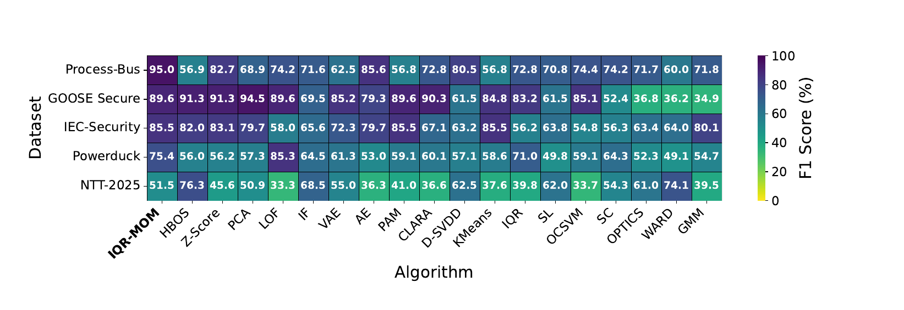
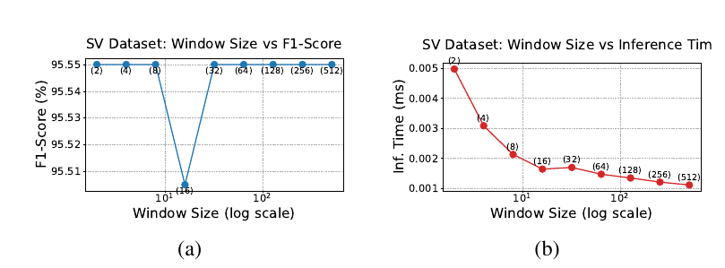
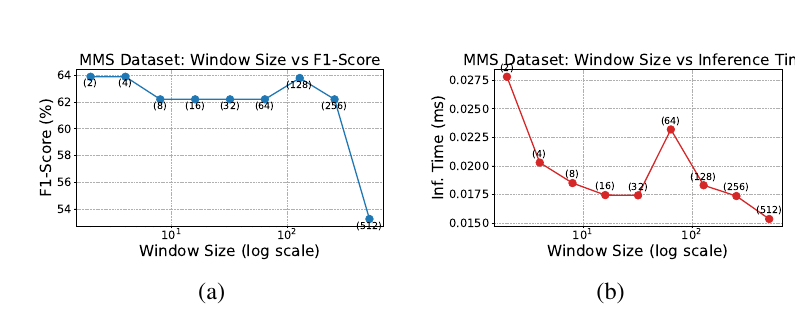
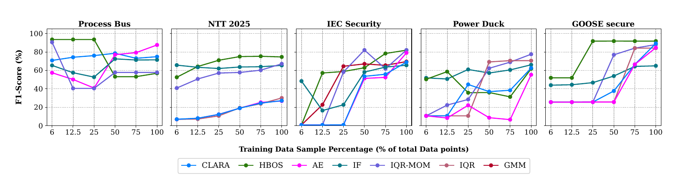
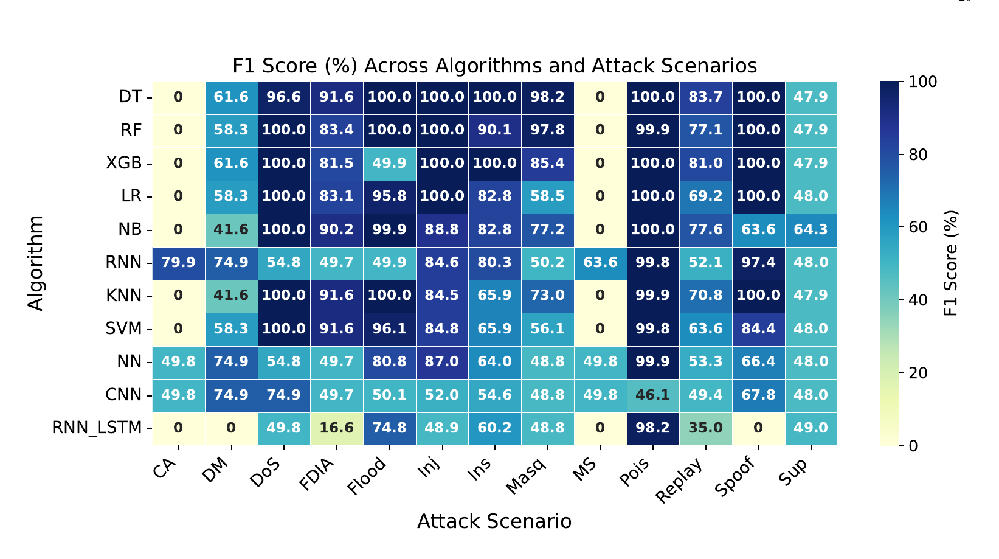
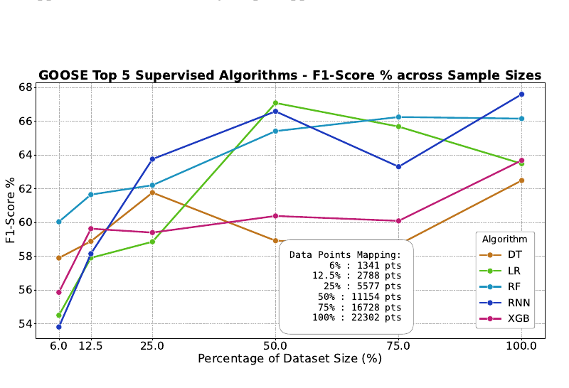
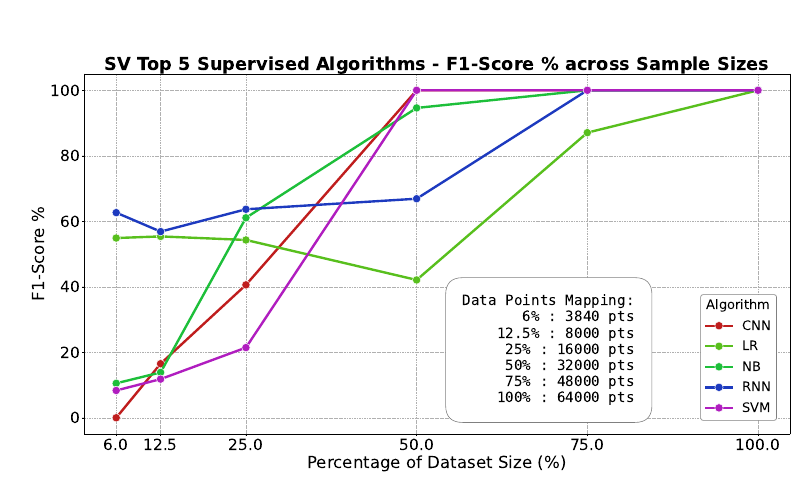
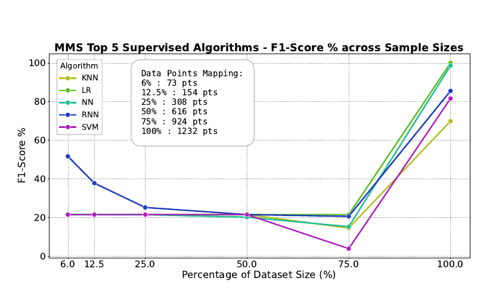
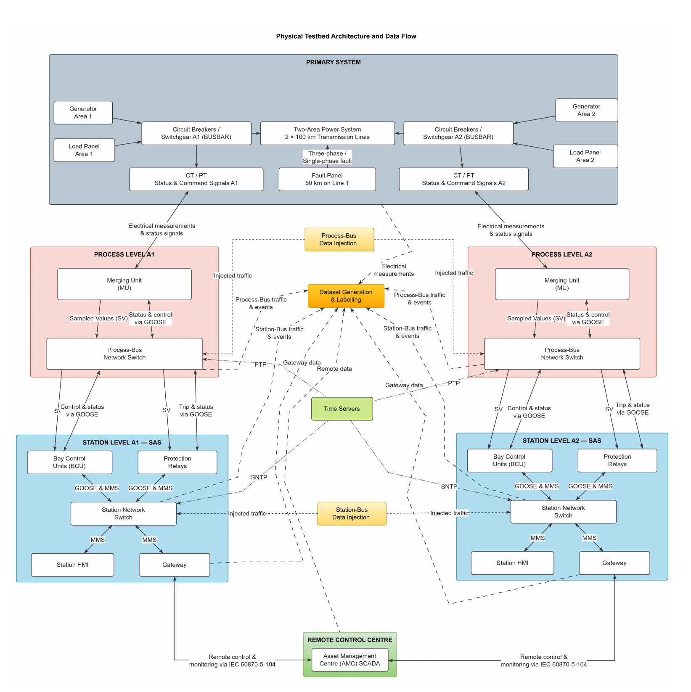

# Supplementary Material

## Lightweight Unsupervised Anomaly Detection for IEC 61850 Digital Substations: Multi-Protocol Benchmarking and Edge Deployment

*Shailja Sharma, Kunal A. Wasnik, V Srimugdha Mahalakshmi, Anushtha Tamrakar, Rayaan Ghosh, Prasanna Mathavan J.T, Harshavardhan P V, Charan Teja, Vishwajeet Pattanaik, Punit Rathore, Gurunath Gurrala, Akhil Sundaran, Saumya Singh, and Kiran T S*

**Contents**

- [S-I. Description of Fields Inside a GOOSE Packet](#s-i)
- [S-II. Dataset Description and Attack Aggregation](#s-ii)
- [S-III. GOOSE Results: Individual Datasets](#s-iii)
- [S-IV. Window Size Analysis](#s-iv)
- [S-V. Training Dataset Size Analysis](#s-v)
- [S-VI. Detailed Discussion of SV and MMS](#s-vi)
- [S-VII. Detailed Resource Usage Results](#s-vii)
- [S-VIII. Supervised Learning Results](#s-viii)
- [S-IX. Resource Usage for Supervised Learning](#s-ix)
- [S-X. Attack-Type Sensitivity Analysis: Supervised Models](#s-x)
- [S-XI. Dataset Size Analysis: Supervised Algorithms](#s-xi)
- [S-XII. Testbed](#s-xii)
- [References](#references)

This supplementary material accompanies the paper “Lightweight Unsupervised Anomaly Detection for IEC 61850 Digital Substations: Multi-Protocol Benchmarking and Edge Deployment”. It provides extended protocol descriptions, detailed result tables, additional resource profiling, dataset documentation, and supervised learning analyses that support the main paper. It is organized as follows. Section [S-I](#s-i) describes the structure and semantics of GOOSE packet fields relevant to anomaly detection. Section [S-II](#s-ii) summarizes all datasets and the attack aggregation strategy. Section [S-III](#s-iii) presents detailed results across five GOOSE datasets, highlighting dataset-specific performance variations. Section [S-VI](#s-vi) provides analyses for SV and MMS protocols, emphasizing differences in detection complexity. Section [S-VII](#s-vii) presents additional resource usage tables and analyses for Unsupervised algorithms on PC and Raspberry Pi. Section [S-VIII](#s-viii) and Section [S-VIII](#s-viii) present supervised results and their resource profiles. Section [S-IX](#s-ix) evaluates the impact of dataset size on supervised model performance. Finally, Section [S-X](#s-x) describes the physical testbed used for deployment validation and dataset generation.

## S-I. Description of Fields Inside a GOOSE Packet

GOOSE is a peer-to-peer communication protocol designed for fast transmission of time-critical messages in substations (e.g., trip commands). It operates at the Data Link layer (Layer 2) of the OSI model and is encapsulated within Ethernet frames. GOOSE follows a publisher–subscriber model, where one IED broadcasts messages to multiple subscribing IEDs. The multicast destination MAC address $01:0c:cd:01:xx:xx$ is reserved for this purpose, and the EtherType assigned by IEEE for GOOSE is $0x88B8$. Table [T1](#t1) describes the fields in a typical GOOSE packet. The *gocbRef* parameter serves as a unique publisher identifier, enabling the same event to be delivered to multiple subscribers. Under normal operation, messages are transmitted periodically at a configurable heartbeat interval (typically one to a few seconds; about 1.2 s in our testbed), with only the sequence number (*sqNum*) being updated. When an event occurs, the transmission rate increases and gradually stabilizes, typically following an exponential back-off mechanism until it reaches the steady-state interval.

The GOOSE message payload is contained in the *allData* field, which represents a list of user-defined variables from the MMS NamedVariableList specified in the GOOSE control block. The *ndsCom* parameter indicates whether the device requires commissioning, while *confRev* denotes the dataset's number of configuration revisions. If the *confRev* value does not match between the publisher and subscriber, the message may be discarded. Most fields, except for sequence numbers, timestamps, and data values, remain constant during normal substation operation. These relatively static fields provide an effective sanity check for validating legitimate GOOSE packets in real-time environments, where low-latency decision-making is critical.

**Table T1. Structure of a Typical GOOSE Packet**

| **Field Name** | **Description** | **Function** | **Data Type** |
|---|---|---|---|
| *gocbRef* | GOOSE Control Block Reference | Unique path name of the GOOSE Control Block | String |
| *timeAllowedtoLive* | Time to Live | Maximum time in milliseconds a GOOSE subscriber waits before declaring the publisher offline | INT32 |
| *datSet* | Data Set | Predefined list of data attributes (status, commands, etc.) included in the GOOSE message | String |
| *goID* | GOOSE ID | User-defined name for a GOOSE Control Block Reference | String |
| $t$ | Timestamp | UTC timestamp when the attribute *stNum* was last updated | UTCTime |
| *stNum* | Status Number | Incremented by one every time an event occurs (e.g., circuit breaker trip) | INT32 |
| *sqNum* | Sequence Number | Incremented every time a GOOSE message is sent, reset to 0 when *stNum* changes | INT32 |
| *simulation* | Simulation | If *True*, indicates the message is from a simulation and not real and should not be used for operations | BOOL |
| *confRev* | Configuration Revision | Number of times the configuration of the dataset has changed | INT32 |
| *ndsCom* | Needs Commissioning | If *True*, indicates the device is not yet commissioned for operation | BOOL |
| *numDatSetEntries* | Number of Dataset Entries | Number of entries present in the *allData* field | INT32 |
| *allData* | All Data | Sequence of values (status, control, etc.) from the MMS NamedVariableList as defined in the GOOSE control block | Sequence of Data |

## S-II. Dataset Description and Attack Aggregation

In this section, we describe the different attack categories and their distribution across the GOOSE datasets. We also outline the aggregation strategy used for the attack-type sensitivity analysis presented in the main document. Table [T2](#t2) provides a detailed breakdown of all datasets, whereas Table [T3](#t3) describes our attack aggregation strategy, while Table [T4](#t4) provides a summary of all the unsupervised algorithms used in this study.

**Table T2. Dataset Description**

| **Dataset** | **Attack Type** | **Sub-Type** | **Description** | **Attack** | **Normal** |
|---|---|---|---|---|---|
| PowerDuck [[1](#ref-1)] | Insertion | Insertion_1 | realistic breaker transition with intermediate packets | 150 | 304 |
|  |  | Insertion_2 | Abruptly signals breaker open without transition | 145 | 316 |
|  |  | Insertion_3 | Slowly increases voltage over time | 1509 | 2147 |
|  |  | Insertion_4 | Slowly decreases voltage over time | 1481 | 2380 |
|  |  | Insertion_5 | Sharp increase in voltage | 154 | 880 |
|  |  | Insertion_6 | Sharp decrease in voltage | 192 | 872 |
|  | Suppression | Suppression_1 | Rapid suppression using sequential state numbers | 158 | 483 |
|  |  | Suppression_2 | Slower suppression with 1s delay between packets | 188 | 515 |
|  |  | Suppression_3 | Slower suppression with 2s delay | 216 | 596 |
|  |  | Suppression_4 | Jumping to 1 step higher stNum in a single step | 164 | 523 |
|  |  | Suppression_5 | Jumping to 2 steps higher stNum in a single step | 176 | 543 |
|  | Flood | Flood_1 | Flooding by repeating old packets of normal size | 484000 | 484332 |
|  |  | Flood_2 | Flooding by increasing payload of each packet | 560000 | 560362 |
|  | Replay | Replay_1 | Replay breaker open without any preceding packets | 2 | 170 |
|  |  | Replay_2 | Replay old packets with preceding packets | 27 | 194 |
|  |  | Replay_3 | Replaying old measurement data | 81 | 393 |
| IEC-Security [[2](#ref-2)] | Composite_attack | Composite_attack | Composite stealthy attack scenario | 2 | 31800 |
|  | Data_Manipulation | Data_Manipulation_1 | GOOSE message data manipulation scenario 1 | 3 | 31800 |
|  |  | Data_Manipulation_2 | GOOSE message data manipulation scenario 2 | 1 | 31800 |
|  |  | Data_Manipulation_3 | GOOSE message data manipulation scenario 3 | 2 | 31805 |
|  | Denial_of_service | Denial_of_service | Excessive GOOSE messages simulating DoS attack | 10009 | 31778 |
|  | Message_Suppression | Message_Suppression_1 | Suppressing GOOSE messages scenario 1 | 2 | 31800 |
|  |  | Message_Suppression_2 | Suppressing GOOSE messages scenario 2 | 2 | 31800 |
|  |  | Message_Suppression_3 | Suppressing GOOSE messages scenario 3 | 2 | 31800 |
|  |  | Message_Suppression_4 | Suppressing GOOSE messages scenario 4 | 2 | 31800 |
| Goose-Secure [[3](#ref-3)] | Spoofing_attack | Scenario_3 | Spoofing GOOSE in stable grid conditions | 26 | 32 |
|  |  | Scenario_4 | Spoofing GOOSE in faulty grid conditions | 60 | 124 |
| ProcessBus [[4](#ref-4)] | False_Data_Injection_attack | False_Data_Injection | Injecting false sensor data | 296 | 3835 |
|  | Replay_attack | Replay | Replay old GOOSE packets | 1297 | 3889 |
| NTT-2025 [[5](#ref-5)] | Replay_attack | Replay_attack | Replays old GOOSE packets after delay | 100 | 10117 |
|  | Message_injection | Message_injection | Sends forged GOOSE frames with random IDs | 100 | 8351 |
|  | Masquerade_attack | Masquerade_attack | Mimics legitimate event-driven GOOSE bursts | 100 | 6360 |
|  | Poisoning_(high rate) | Poisoning_(high rate) | Floods network with excessive GOOSE traffic | 2000 | 3100 |

**Table T3. Attack Category Aggregation Mapping**

| **Aggregated Category** | **Mapped Labels** |
|---|---|
| Flood | flood1, flood2 |
| Insertion | insertion1, insertion2, insertion_3–6 |
| Suppression | suppression1–5, suppression |
| Replay | replay1, replay2, replay_3, 901/ 903/ 904/ 905/ 907/ 9072_replay, replay |
| FDIA | 902/ 904/ 908_FDIA |
| Data Manipulation | DM1–3 |
| Message Suppression | MS1–4 |
| Denial of Service | DoS1, DoS2 |
| Spoofing | spoofing_fault, spoofing_stable |
| Injection | injection |
| Masquerade | masquerade |
| Poisoning | poisoning |
| Combined Attack | CS1 (Composite_attack) |

**Table T4. Summary of algorithms used for benchmarking**

| **Algorithm** | **Full Name** | **Description** | **Ref.** |
|---|---|---|---|
| AE | Autoencoder | Feed-forward neural network trained to reconstruct normal traffic using a compressed latent representation. Anomalies are detected using reconstruction error between the input and decoded output. |  |
| VAE | Variational Autoencoder | Probabilistic autoencoder that learns a latent distribution using variational inference and KL divergence regularization. Anomalies correspond to samples with high reconstruction error under the learned distribution. |  |
| PCA | Principal Component Analysis | Linear dimensionality reduction technique that reconstructs data using principal components learned from normal traffic. Anomalies correspond to high reconstruction errors. |  |
| IF | Isolation Forest | Ensemble anomaly detection algorithm that isolates observations using randomly generated decision trees. Anomalies tend to have shorter average path lengths during isolation. | [[6](#ref-6)] |
| LOF | Local Outlier Factor | Density-based method measuring local density deviation relative to neighboring points. In novelty detection mode, the model is trained on normal-only data and detects anomalies with significantly lower local density. | [[7](#ref-7)] |
| OCSVM | One-Class Support Vector Machine | Kernel-based anomaly detector that learns a hypersurface enclosing normal data in feature space. Points lying outside the learned boundary are classified as anomalies. | [[8](#ref-8)] |
| Deep-SVDD | Deep Support Vector Data Description | Neural-network-based anomaly detector that maps normal data into a minimum-volume hypersphere in latent space. Anomalies correspond to samples lying far from the learned center. | [[9](#ref-9)] |
| HBOS | Histogram-Based Outlier Score | Density-based method that models each feature independently using histograms estimated from normal-only training data. Anomaly scores are computed as the sum of negative log-density values across features. | [[10](#ref-10)] |
| CLARA | Clustering Large Applications | Extension of PAM that performs clustering on multiple random subsamples and selects medoids minimizing global clustering cost. Anomaly scores are defined as distances to the nearest medoid. | [[11](#ref-11)] |
| GMM | Gaussian Mixture Model | Probabilistic density model representing normal traffic as a mixture of Gaussian distributions estimated via Expectation–Maximization. Samples with low likelihood under the learned distribution are considered anomalous. | [[12](#ref-12)] |
| k-means | k-means Clustering | Partition-based clustering algorithm minimizing within-cluster Euclidean variance. A single centroid learned from normal data represents legitimate traffic structure, and anomalies correspond to large centroid distances. | [[13](#ref-13)] |
| PAM | Partitioning Around Medoids | Clustering method using actual data samples as medoids to minimize total dissimilarity within clusters. Anomaly scores correspond to distances from the nearest learned medoid. | [[14](#ref-14)] |
| OPTICS | Ordering Points To Identify Clustering Structure | Density-based clustering method that characterizes cluster structure using reachability distances computed across the full dataset. Samples with large reachability distances correspond to anomalies. | [[15](#ref-15)] |
| Single Linkage | Hierarchical Clustering | Agglomerative clustering algorithm that merges clusters based on minimum pairwise distance. Anomaly scores are derived from merge heights in the resulting dendrogram. | [[16](#ref-16)] |
| Spectral Clustering | Spectral Graph Clustering | Graph-based clustering technique using eigen-decomposition of the graph Laplacian to identify clusters in a low-dimensional spectral embedding space. | [[17](#ref-17)] |
| Ward | Ward's Linkage | Hierarchical clustering approach that merges clusters by minimizing within-cluster variance (error sum of squares), producing compact clusters. | [[18](#ref-18)] |
| IQR | Interquartile Range Detector | Robust non-parametric statistical method that estimates feature dispersion using quartiles and flags samples violating the interquartile bounds. |  |
| Z-score | Z-score Detector | Statistical baseline that models each feature using its mean and standard deviation estimated from normal-only training data. Anomalies are detected based on large standardized deviations. |  |

### A. GOOSE Dataset Characteristics

The five GOOSE datasets considered in this study vary significantly in size, class balance, and attack diversity (Table [T2](#t2)), providing a comprehensive evaluation setting.

The PowerDuck dataset is the most diverse, with multiple attack categories, including insertion, suppression, flood, and replay, and fine-grained sub-scenarios. It spans both small-scale attacks (tens to hundreds of samples) and extremely large-scale flood scenarios (up to $5.6\times10^5$ packets), making it suitable for evaluating robustness across both subtle and high-volume attacks. In contrast, the IEC_61850_Security dataset is highly imbalanced, with very few attack samples (often $<5$) against a large normal baseline ($\sim3.18\times10^4$), except for the DoS scenario. This dataset emphasizes detection under extreme class imbalance and stealthy attack conditions.

The Goose_Secure dataset is relatively small, with limited samples (tens to hundreds), focusing specifically on spoofing attacks under both stable and fault conditions. The ProcessBus dataset provides a moderate-scale setting with two well-defined attack types (false data injection and replay), offering a balanced evaluation of data integrity and temporal attacks. Finally, the NTT-2025 dataset introduces realistic and diverse attack patterns, including replay, injection, masquerade, and high-rate poisoning, with varying degrees of class imbalance and complexity. Overall, these datasets collectively cover a wide spectrum of attack behaviors, ranging from deterministic manipulations and timing-based attacks to high-volume flooding and stealthy masquerade scenarios. This diversity is essential for evaluating the generalization capability of anomaly detection algorithms across different operational conditions in IEC 61850-based substations.

### B. Attack Aggregation Strategy

To ensure consistency across heterogeneous datasets, we consolidated fine-grained attack labels into a unified set of high-level attack categories (Table [T3](#t3)). This aggregation groups semantically similar attack variants under common classes, reducing label fragmentation while preserving the underlying attack characteristics.

However, we intentionally did not combine certain categories across datasets. Flood and Denial-of-Service attacks were kept separate, as they differ significantly in both packet volume and attack methodology. Likewise, Insertion, Data Manipulation, Injection, and FDIA were not merged across datasets, since their operational characteristics and underlying mechanisms differ, although aggregation was performed within individual datasets where appropriate.

Some attack categories, such as Masquerade, Spoofing, and Poisoning, do not align cleanly with other groups and were therefore retained as distinct classes. For Spoofing, we combined only scenarios within the same dataset (fault and stable conditions) because of their consistent attack structure.

We aggregated replay attacks across all datasets because they follow a well-defined, consistent methodology. Similarly, Message Suppression attacks, which exploit the *stNum* vulnerability in GOOSE communication, behave similarly across scenarios and were grouped. By reducing the number of classes while maintaining semantic meaning, this aggregation improves statistical reliability and enables a more structured analysis of algorithm performance across broader attack families. It also reflects realistic deployment conditions, where detection systems must generalize across variations of attack types rather than rely on narrowly defined signatures.

## S-III. GOOSE Results: Individual Datasets

**Fig. F1.** Heatmap of F1-scores for unsupervised algorithms across different GOOSE datasets. We evaluated Single Linkage (SL), Ward, OPTICS, and Spectral Clustering (SC) in a transductive setting directly on the test data, primarily to illustrate the datasets' theoretical separability rather than realistic deployment scenarios. Each reported F1-score represents the average over five independent runs.

Looking more closely at performance on individual GOOSE datasets (Fig. [F1](#f1)), we observe that IQR-MOM outperforms the standard IQR-based detector on highly skewed datasets such as IEC-Security, where traditional statistical detectors often struggle. Furthermore, the proposed method surpasses several widely used anomaly detection approaches, including IF, clustering-based methods such as GMM, and deep learning-based AE on the Goose-Secure dataset, which contains relatively few samples for learning the normal baseline. This highlights the robustness of the proposed statistical aggregation mechanism even in scenarios with limited training data.

However, the proposed method performs poorly on the NTT-2025 dataset. This dataset contains diverse attack types, including replay, injection, masquerade, and high-rate poisoning. The masquerade scenarios include malicious packets designed to resemble normal traffic. As a result, attack packets' feature distributions closely resemble those of legitimate traffic, making it difficult for statistical models to distinguish anomalies based solely on deviations from baseline distributions. In such cases, even established anomaly detection algorithms such as LOF and other methods, including k-means, GMM, and AE, struggle to separate attack and normal samples effectively. Among the evaluated algorithms, IF demonstrates relatively stable performance across datasets, as shown in Fig. [F1](#f1). This behavior arises from IF's isolation-based mechanism, which can sometimes better isolate rare observations, even when feature deviations are subtle. We discuss the performance on GOOSE datasets in detail in the following sections.

Tables [T5](#t5)–[T9](#t9) summarize the detailed results of the unsupervised algorithms across the five GOOSE datasets.

### A. ProcessBus Dataset

**Table T5. GOOSE Results: ProcessBus**

| **Algorithms** | **Acc** | **Prec (Anom)** | **Prec** | **Rec (Anom)** | **Rec** | **F1 (Anom)** | **F1** | **Bal Acc** | **MCC** | **PR-AUC** | **ROC-AUC** |
|---|---|---|---|---|---|---|---|---|---|---|---|
| AE | **99.11** | **64.36** | **81.99** | 83.33 | 91.40 | **71.74** | **85.64** | 91.40 | **0.72** | 65.98 | 99.55 |
| VAE | 97.81 | 28.98 | 63.58 | 27.47 | 63.54 | 26.05 | 62.47 | 63.54 | 0.26 | 51.11 | 93.13 |
| PCA | 98.40 | 39.59 | 69.05 | 38.09 | 68.98 | 38.54 | 68.86 | 68.98 | 0.38 | 50.40 | 54.74 |
| IF | 98.47 | 43.02 | 70.94 | 46.83 | 73.21 | 43.92 | 71.57 | 73.21 | 0.44 | 60.28 | 98.69 |
| LOF | 96.87 | 37.43 | 68.55 | <ins>84.72</ins> | 90.92 | 50.07 | 74.22 | 90.92 | 0.54 | 53.91 | 92.37 |
| OCSVM | 97.24 | 39.21 | 69.40 | 78.65 | 88.12 | 50.31 | 74.44 | 88.12 | 0.53 | 60.37 | 92.68 |
| D-SVDD | 97.45 | 49.76 | 74.88 | **<ins>100.00</ins>** | **<ins>98.70</ins>** | 62.39 | 80.53 | **<ins>98.70</ins>** | <ins>0.67</ins> | **<ins>83.99</ins>** | **<ins>99.79</ins>** |
| CLARA | 98.45 | 42.05 | 70.47 | 53.00 | 76.27 | 46.36 | 72.78 | 76.27 | 0.46 | 60.60 | 94.35 |
| GMM | 98.50 | 40.39 | 69.68 | 50.00 | 74.75 | 44.30 | 71.77 | 74.75 | 0.44 | 73.59 | **99.63** |
| k-means | 97.43 | 13.43 | 55.63 | 16.67 | 58.12 | 14.87 | 56.78 | 58.12 | 0.14 | 66.08 | 99.56 |
| OPTICS | 96.13 | 36.08 | 67.59 | 75.37 | 86.14 | 45.32 | 71.66 | 86.14 | 0.48 | 58.45 | 98.61 |
| PAM | 97.43 | 13.43 | 55.63 | 16.67 | 58.12 | 14.87 | 56.78 | 58.12 | 0.14 | 66.08 | 99.56 |
| SingleLinkage | 95.88 | 34.01 | 66.58 | 75.44 | 86.03 | 43.72 | 70.79 | 86.03 | 0.47 | 38.42 | 97.90 |
| SpectralClustering | 96.56 | 40.82 | 70.17 | 75.00 | 85.97 | 50.22 | 74.21 | 85.97 | 0.52 | 71.09 | 86.47 |
| WARD | 77.46 | 33.99 | 66.35 | 50.00 | 64.02 | 34.60 | 60.05 | 64.02 | 0.32 | 66.08 | 99.56 |
| HBOS | 97.45 | 13.82 | 55.83 | 16.67 | 58.13 | 15.09 | 56.90 | 58.13 | 0.14 | 80.08 | 99.59 |
| IQR | 95.28 | 32.89 | 66.44 | **<ins>100.00</ins>** | **97.58** | 48.05 | 72.78 | **97.58** | 0.55 | <ins>80.65</ins> | 99.57 |
| Z-score | <ins>98.98</ins> | <ins>59.71</ins> | <ins>79.56</ins> | 75.00 | 87.27 | <ins>65.92</ins> | <ins>82.70</ins> | 87.27 | 0.66 | 80.41 | 99.56 |
| IQR-MOM | **<ins>99.67</ins>** | **<ins>91.65</ins>** | **<ins>95.71</ins>** | **91.23** | <ins>95.56</ins> | **<ins>90.10</ins>** | **<ins>94.96</ins>** | <ins>95.56</ins> | **<ins>0.91</ins>** | **81.53** | <ins>99.62</ins> |

*Note:* Ranking legend: **<ins>1st</ins>**, **2nd**, <ins>3rd</ins>.

The ProcessBus results (Table [T5](#t5)) show that IQR-MOM achieves the strongest overall performance, with the highest $F_1$-score (94.96%), precision (95.71%), and MCC (0.91), while maintaining 91.23% anomaly recall. AE and D-SVDD also perform well, although D-SVDD's perfect recall comes with lower precision and a reduced $F_1$-score. Z-score remains competitive ($F_1=82.70\%$, MCC=0.66), whereas IQR achieves high recall at the expense of precision. Clustering methods generally perform worse, indicating limited separability of attack patterns. Overall, the results suggest that robust statistical aggregation captures ProcessBus anomalies better than clustering alone, with IQR-MOM providing the best balance between detection performance and false-positive control.

### B. PowerDuck Dataset

**Table T6. GOOSE Results: PowerDuck**

| **Algorithms** | **Acc** | **Prec (Anom)** | **Prec** | **Rec (Anom)** | **Rec** | **F1 (Anom)** | **F1** | **Bal Acc** | **MCC** | **PR-AUC** | **ROC-AUC** |
|---|---|---|---|---|---|---|---|---|---|---|---|
| AE | 81.33 | 18.87 | 54.48 | 37.08 | 63.21 | 19.75 | 52.95 | 63.21 | 0.17 | 44.98 | 65.72 |
| VAE | 89.94 | 36.49 | 63.39 | 31.25 | 65.42 | 30.73 | 61.27 | 65.42 | 0.30 | 40.74 | 71.75 |
| PCA | 86.35 | 22.48 | 56.31 | 31.25 | 63.15 | 24.99 | 57.32 | 63.15 | 0.21 | 41.18 | 77.86 |
| IF | 89.70 | 33.26 | 64.40 | 50.25 | 71.15 | 35.33 | 64.50 | 71.15 | 0.32 | 40.98 | 90.60 |
| LOF | **<ins>96.33</ins>** | **<ins>61.76</ins>** | **<ins>80.88</ins>** | **<ins>100.00</ins>** | **<ins>97.66</ins>** | **<ins>72.94</ins>** | **<ins>85.27</ins>** | **<ins>97.66</ins>** | **<ins>0.75</ins>** | **<ins>75.21</ins>** | **<ins>98.94</ins>** |
| OCSVM | 82.44 | 24.46 | 57.76 | 62.50 | 75.82 | 31.01 | 59.07 | 75.82 | 0.29 | 52.36 | 62.13 |
| D-SVDD | 80.30 | 44.24 | 63.47 | 42.65 | 69.84 | 30.56 | 57.11 | 69.84 | 0.30 | 59.66 | 89.76 |
| CLARA | 90.43 | 25.25 | 59.59 | 35.56 | 65.56 | 26.87 | 60.11 | 65.56 | 0.25 | 40.23 | 68.46 |
| GMM | <ins>91.11</ins> | 22.99 | 53.44 | 37.50 | 59.36 | 27.27 | 54.74 | 59.36 | 0.12 | 41.00 | 79.00 |
| k-means | 88.85 | 26.31 | 58.29 | 31.25 | 64.80 | 25.98 | 58.58 | 64.80 | 0.25 | 46.47 | 65.72 |
| OPTICS | 79.07 | 28.73 | 55.31 | 35.55 | 59.72 | 21.83 | 52.31 | 59.72 | 0.13 | 50.99 | 74.41 |
| PAM | 89.09 | 27.54 | 58.90 | 31.25 | 64.93 | 26.96 | 59.14 | 64.93 | 0.25 | 43.61 | 81.92 |
| SingleLinkage | 78.46 | 17.98 | 49.85 | 27.66 | 55.67 | 16.91 | 49.75 | 55.67 | 0.15 | 19.26 | 65.64 |
| SpectralClustering | 82.32 | **55.51** | <ins>69.63</ins> | 40.80 | 63.31 | 43.90 | 64.29 | 63.31 | 0.44 | 59.28 | 69.62 |
| WARD | 73.74 | 10.21 | 50.07 | 46.67 | 61.36 | 16.73 | 49.07 | 61.36 | 0.17 | <ins>66.42</ins> | 92.47 |
| HBOS | 87.53 | 25.46 | 57.06 | 24.34 | 61.40 | 21.69 | 56.05 | 61.40 | 0.20 | **74.10** | <ins>93.19</ins> |
| IQR | 87.95 | 38.81 | 69.36 | **94.44** | **89.78** | <ins>50.01</ins> | <ins>70.95</ins> | **89.78** | <ins>0.52</ins> | 41.41 | 88.31 |
| Z-score | 87.34 | 21.96 | 56.11 | 31.25 | 63.97 | 22.09 | 56.19 | 63.97 | 0.21 | 51.59 | 62.20 |
| IQR-MOM | **94.54** | <ins>52.96</ins> | **75.25** | <ins>64.92</ins> | <ins>80.35</ins> | **54.24** | **75.44** | <ins>80.35</ins> | **0.53** | 53.73 | **94.63** |

*Note:* Ranking legend: **<ins>1st</ins>**, **2nd**, <ins>3rd</ins>.

The results on the PowerDuck dataset (Table [T6](#t6)) show a different performance trend compared to the ProcessBus dataset. In this case, LOF achieves the best overall performance with the highest $F_1$-score (85.27%) and MCC (0.75), along with perfect anomaly recall (100%). This indicates that density-based methods are particularly effective for this dataset, where attack patterns appear as locally sparse deviations from normal traffic. The proposed IQR-MOM method achieves the second-best overall performance, with an $F_1$-score of 75.44% and MCC of 0.53. It maintains a good balance between precision (75.25%) and recall (64.92%), indicating stable detection without excessive false positives. Compared to IQR, which achieves very high recall (94.44%) but lower precision, IQR-MOM offers a more balanced trade-off and improves overall performance.

Most statistical and clustering-based methods perform moderately to poorly. Z-score and PCA perform poorly because they rely on global distributions, which are less effective for heterogeneous attack patterns. Similarly, clustering methods such as k-means, PAM, and GMM fail to capture meaningful separation, indicating that attack samples do not form distinct clusters in feature space.

Reconstruction-based methods (AE, VAE) and margin-based methods (OCSVM, D-SVDD) also perform poorly, suggesting that variability in PowerDuck traffic makes it difficult to learn a consistent normal baseline. In contrast, IF provides moderate performance, benefiting from its ability to isolate anomalies, but still underperforms compared to LOF. Overall, PowerDuck favors locally adaptive detection, explaining LOF's strong performance, while IQR-MOM remains competitive through its robust aggregation strategy.

### C. GOOSE-Secure Dataset

**Table T7. GOOSE Results: GOOSE-Secure**

| **Algorithms** | **Acc** | **Prec (Anom)** | **Prec** | **Rec (Anom)** | **Rec** | **F1 (Anom)** | **F1** | **Bal Acc** | **MCC** | **PR-AUC** | **ROC-AUC** |
|---|---|---|---|---|---|---|---|---|---|---|---|
| AE | 79.38 | 70.00 | 85.00 | **<ins>100.00</ins>** | 85.22 | 79.23 | 79.35 | 85.22 | 0.70 | **<ins>100.00</ins>** | **<ins>100.00</ins>** |
| VAE | 88.12 | **87.50** | 89.82 | **81.66** | 87.27 | 78.71 | 85.15 | 87.27 | 0.76 | **<ins>100.00</ins>** | **<ins>100.00</ins>** |
| PCA | **<ins>95.00</ins>** | **87.50** | **<ins>93.75</ins>** | **<ins>100.00</ins>** | **<ins>96.43</ins>** | **<ins>92.86</ins>** | **<ins>94.50</ins>** | **<ins>96.43</ins>** | **<ins>0.90</ins>** | **<ins>100.00</ins>** | **<ins>100.00</ins>** |
| IF | 76.25 | 62.50 | 72.32 | <ins>58.34</ins> | 73.09 | 55.35 | 69.50 | 73.09 | 0.45 | 80.82 | 90.40 |
| LOF | 90.00 | 80.00 | <ins>90.00</ins> | **<ins>100.00</ins>** | 92.86 | 87.50 | 89.59 | 92.86 | <ins>0.83</ins> | **<ins>100.00</ins>** | **<ins>100.00</ins>** |
| OCSVM | 85.62 | 70.84 | 85.41 | **<ins>100.00</ins>** | 88.93 | 82.85 | 85.09 | 88.93 | 0.74 | **<ins>100.00</ins>** | **<ins>100.00</ins>** |
| D-SVDD | 74.38 | **<ins>100.00</ins>** | 86.11 | 25.00 | 62.50 | 39.28 | 61.52 | 62.50 | 0.42 | **98.06** | **99.05** |
| CLARA | <ins>90.88</ins> | 78.85 | 89.43 | **<ins>100.00</ins>** | <ins>93.22</ins> | <ins>87.94</ins> | <ins>90.28</ins> | <ins>93.22</ins> | 0.83 | **<ins>100.00</ins>** | **<ins>100.00</ins>** |
| GMM | 40.00 | 36.43 | 43.22 | **<ins>100.00</ins>** | 55.00 | 53.08 | 34.88 | 55.00 | 0.15 | **<ins>100.00</ins>** | **<ins>100.00</ins>** |
| k-means | 85.00 | 75.00 | 87.50 | **<ins>100.00</ins>** | 89.28 | 83.34 | 84.85 | 89.28 | 0.77 | **<ins>100.00</ins>** | **<ins>100.00</ins>** |
| OPTICS | 58.12 | 0.00 | 31.66 | 0.00 | 43.93 | 0.00 | 36.75 | 43.93 | -0.21 | 33.15 | 40.18 |
| PAM | 90.00 | 80.00 | <ins>90.00</ins> | **<ins>100.00</ins>** | 92.86 | 87.50 | 89.59 | 92.86 | <ins>0.83</ins> | **<ins>100.00</ins>** | **<ins>100.00</ins>** |
| SingleLinkage | 74.38 | **<ins>100.00</ins>** | 86.11 | 25.00 | 62.50 | 39.28 | 61.52 | 62.50 | 0.42 | 65.09 | 63.57 |
| SpectralClustering | 68.12 | 50.00 | 59.45 | 16.66 | 55.84 | 25.00 | 52.38 | 55.84 | 0.15 | 53.75 | 52.50 |
| WARD | 45.83 | 66.67 | 55.55 | 11.11 | 38.89 | 19.05 | 36.19 | 38.89 | 0.22 | 54.52 | 61.11 |
| HBOS | **91.88** | <ins>80.35</ins> | **90.18** | **<ins>100.00</ins>** | **93.93** | **89.01** | **91.27** | **93.93** | **0.84** | **<ins>100.00</ins>** | **<ins>100.00</ins>** |
| IQR | 83.75 | 67.50 | 83.75 | **<ins>100.00</ins>** | 87.85 | 80.35 | 83.23 | 87.85 | 0.72 | 85.26 | 91.67 |
| Z-score | **91.88** | <ins>80.35</ins> | **90.18** | **<ins>100.00</ins>** | **93.93** | **89.01** | **91.27** | **93.93** | **0.84** | **<ins>100.00</ins>** | **<ins>100.00</ins>** |
| IQR-MOM | 90.00 | 80.00 | <ins>90.00</ins> | **<ins>100.00</ins>** | 92.86 | 87.50 | 89.59 | 92.86 | <ins>0.83</ins> | <ins>94.05</ins> | <ins>95.83</ins> |

*Note:* Ranking legend: **<ins>1st</ins>**, **2nd**, <ins>3rd</ins>.

The results for the Goose-Secure dataset in Table [T7](#t7) show substantial differences among the unsupervised algorithms. PCA performs best, achieving 95.00% accuracy, 100% anomaly recall, 92.86% anomaly F1-score, and an MCC of 0.90. LOF, CLARA, PAM, HBOS, and Z-score also perform well, with anomaly F1-scores ranging from 87.50% to 89.01% and balanced accuracy above 92%. IQR-MOM achieves 90.00% accuracy, 100% anomaly recall, 87.50% anomaly F1-score, and an MCC of 0.83, while maintaining a relatively strong ROC-AUC of 95.83%.

Several methods show a clear trade-off between anomaly detection and false-positive control. AE and OCSVM detect all anomalous samples but achieve lower precision, resulting in anomaly F1-scores of 79.23% and 82.85%, respectively. D-SVDD and SingleLinkage achieve 100% anomaly precision but detect only 25% of the anomalies, leading to substantially lower F1-scores. OPTICS performs poorly, with zero anomaly recall and an MCC of $-0.21$, indicating that it fails to identify the anomalous traffic effectively. GMM also shows weak classification performance despite achieving perfect anomaly recall, with an anomaly F1-score of only 53.08%. These results also show that high PR-AUC and ROC-AUC do not necessarily correspond to strong classification at the selected operating point; for example, GMM achieves 100% for both AUC measures but only 53.08% anomaly F1-score.

### D. IEC-Security Dataset

**Table T8. GOOSE Results: IEC-Security**

| **Algorithms** | **Acc** | **Prec (Anom)** | **Prec** | **Rec (Anom)** | **Rec** | **F1 (Anom)** | **F1** | **Bal Acc** | **MCC** | **PR-AUC** | **ROC-AUC** |
|---|---|---|---|---|---|---|---|---|---|---|---|
| AE | 97.12 | <ins>48.91</ins> | 74.44 | **97.14** | 97.13 | 60.97 | 79.71 | 97.13 | 0.65 | 63.58 | 97.99 |
| VAE | 98.50 | 34.45 | 67.13 | 77.14 | 87.91 | 45.36 | 72.30 | 87.91 | 0.50 | 64.05 | 96.66 |
| PCA | 98.81 | 46.77 | 73.35 | <ins>92.86</ins> | 95.86 | 60.00 | 79.69 | 95.86 | 0.64 | 62.66 | 97.71 |
| IF | 95.16 | 25.26 | 62.63 | **<ins>100.00</ins>** | 97.56 | 33.73 | 65.61 | 97.56 | 0.44 | 35.73 | 97.54 |
| LOF | 93.15 | 10.81 | 55.41 | **<ins>100.00</ins>** | 96.55 | 19.51 | 57.97 | 96.55 | 0.32 | 78.57 | <ins>99.64</ins> |
| OCSVM | 90.91 | 7.81 | 53.88 | <ins>92.86</ins> | 91.88 | 14.41 | 54.81 | 91.88 | 0.25 | 54.08 | 98.78 |
| D-SVDD | 95.87 | 16.67 | 58.33 | **<ins>100.00</ins>** | 97.92 | 28.57 | 63.22 | 97.92 | 0.40 | 62.98 | 99.32 |
| CLARA | 92.43 | 28.38 | 64.16 | <ins>92.86</ins> | 92.64 | 38.33 | 67.07 | 92.64 | 0.45 | 60.84 | 95.98 |
| GMM | 99.05 | 45.24 | 72.59 | <ins>92.86</ins> | 95.98 | 60.72 | 80.11 | 95.98 | 0.64 | 61.19 | 98.63 |
| k-means | **99.29** | **<ins>57.14</ins>** | **<ins>78.57</ins>** | **<ins>100.00</ins>** | **<ins>99.64</ins>** | **<ins>71.43</ins>** | **<ins>85.53</ins>** | **<ins>99.64</ins>** | **<ins>0.75</ins>** | 64.29 | 99.41 |
| OPTICS | 95.93 | 16.91 | 58.45 | **<ins>100.00</ins>** | <ins>97.95</ins> | 28.91 | 63.41 | <ins>97.95</ins> | 0.40 | **<ins>92.86</ins>** | **<ins>99.88</ins>** |
| PAM | **99.29** | **<ins>57.14</ins>** | **<ins>78.57</ins>** | **<ins>100.00</ins>** | **<ins>99.64</ins>** | **<ins>71.43</ins>** | **<ins>85.53</ins>** | **<ins>99.64</ins>** | **<ins>0.75</ins>** | 64.29 | 99.41 |
| SingleLinkage | 96.05 | 17.38 | 58.69 | **<ins>100.00</ins>** | **98.01** | 29.59 | 63.78 | **98.01** | 0.41 | 64.29 | 99.41 |
| SpectralClustering | 95.09 | 8.81 | 54.20 | 52.86 | 74.15 | 15.10 | 56.29 | 74.15 | 0.20 | 53.29 | 56.82 |
| WARD | 98.82 | 28.57 | 63.99 | 28.57 | 63.99 | 28.57 | 63.99 | 63.99 | 0.28 | 64.29 | 99.41 |
| HBOS | **<ins>99.29</ins>** | **53.57** | <ins>76.73</ins> | 85.71 | 92.56 | <ins>64.29</ins> | <ins>81.96</ins> | 92.56 | <ins>0.67</ins> | <ins>78.63</ins> | 96.16 |
| IQR | 91.74 | 9.17 | 54.59 | **<ins>100.00</ins>** | 95.83 | 16.79 | 56.22 | 95.83 | 0.29 | 57.14 | 99.40 |
| Z-score | <ins>99.23</ins> | **53.57** | **76.76** | <ins>92.86</ins> | 96.07 | **66.67** | **83.14** | 96.07 | **0.70** | 60.71 | 99.61 |
| IQR-MOM | **99.29** | **<ins>57.14</ins>** | **<ins>78.57</ins>** | **<ins>100.00</ins>** | **<ins>99.64</ins>** | **<ins>71.43</ins>** | **<ins>85.53</ins>** | **<ins>99.64</ins>** | **<ins>0.75</ins>** | **85.71** | **99.88** |

*Note:* Ranking legend: **<ins>1st</ins>**, **2nd**, <ins>3rd</ins>.

The IEC-Security results (Table [T8](#t8)) show high overall accuracy but substantial variation in anomaly-specific performance. IQR-MOM achieves an $F_1$-score of 85.53%, MCC of 0.75, and 100% anomaly recall, while k-means and PAM achieve the same $F_1$ and MCC. HBOS and Z-score also perform strongly. In contrast, IF, LOF, OCSVM, D-SVDD, and IQR tend to achieve high recall at the expense of precision, resulting in lower $F_1$ scores. AE and PCA perform moderately, while Spectral Clustering and WARD perform poorly. Overall, the results indicate that IEC-Security contains statistically and structurally distinguishable anomalies, favoring robust statistical and cluster-based methods.

### E. NTT-2025 Dataset

**Table T9. GOOSE Results: NTT-2025**

| **Algorithms** | **Acc** | **Prec (Anom)** | **Prec** | **Rec (Anom)** | **Rec** | **F1 (Anom)** | **F1** | **Bal Acc** | **MCC** | **PR-AUC** | **ROC-AUC** |
|---|---|---|---|---|---|---|---|---|---|---|---|
| AE | 49.78 | 24.31 | 34.96 | **98.45** | 67.46 | 32.87 | 36.27 | 67.46 | 0.20 | 49.92 | 95.56 |
| VAE | 67.59 | 35.03 | 59.97 | 87.26 | 75.47 | 43.66 | 55.03 | 75.47 | 0.40 | 49.70 | 92.11 |
| PCA | 69.16 | 31.55 | 58.05 | 76.67 | 68.29 | 37.84 | 50.85 | 68.29 | 0.30 | <ins>59.76</ins> | 96.27 |
| IF | <ins>88.04</ins> | 35.06 | <ins>67.21</ins> | 89.35 | **87.06** | <ins>45.87</ins> | <ins>68.47</ins> | **87.06** | <ins>0.47</ins> | 55.99 | **<ins>97.13</ins>** |
| LOF | 48.87 | 21.03 | 35.10 | 85.58 | 60.81 | 27.65 | 33.26 | 60.81 | 0.09 | 37.21 | 63.04 |
| OCSVM | 49.05 | 21.58 | 31.86 | 89.29 | 62.68 | 28.58 | 33.71 | 62.68 | 0.14 | 47.09 | 89.92 |
| D-SVDD | 84.08 | **45.68** | 65.91 | 44.98 | 71.03 | 37.64 | 62.54 | 71.03 | 0.36 | 47.56 | 85.64 |
| CLARA | 51.74 | 23.53 | 38.59 | 90.18 | 64.50 | 31.13 | 36.62 | 64.50 | 0.17 | 48.03 | 92.00 |
| GMM | 54.53 | 24.95 | 47.84 | 89.29 | 65.53 | 32.75 | 39.48 | 65.53 | 0.19 | 54.94 | 95.89 |
| k-means | 51.72 | 26.28 | 41.41 | <ins>90.77</ins> | 64.88 | 34.21 | 37.57 | 64.88 | 0.21 | 49.34 | 95.87 |
| OPTICS | 82.78 | 32.40 | 58.92 | 42.83 | 67.97 | 35.83 | 61.05 | 67.97 | 0.27 | 38.85 | 71.50 |
| PAM | 52.79 | 27.41 | 41.98 | 90.48 | 66.88 | 35.00 | 40.99 | 66.88 | 0.27 | 50.00 | 96.30 |
| SingleLinkage | 82.88 | 33.65 | 59.57 | 45.96 | 69.43 | 37.82 | 62.05 | 69.43 | 0.29 | 38.97 | 65.98 |
| SpectralClustering | 81.87 | 23.15 | 54.07 | 26.11 | 59.73 | 22.77 | 54.34 | 59.73 | 0.14 | 32.42 | 31.29 |
| WARD | **92.55** | **<ins>48.62</ins>** | **<ins>73.61</ins>** | 71.13 | <ins>82.33</ins> | **52.37** | **74.06** | <ins>82.33</ins> | **0.53** | 52.77 | 96.68 |
| HBOS | **<ins>94.45</ins>** | <ins>45.20</ins> | **72.14** | 82.14 | **<ins>88.58</ins>** | **<ins>55.72</ins>** | **<ins>76.35</ins>** | **<ins>88.58</ins>** | **<ins>0.57</ins>** | **<ins>69.13</ins>** | **96.84** |
| IQR | 50.94 | 21.42 | 46.42 | **<ins>100.00</ins>** | 70.66 | 28.71 | 39.84 | 70.66 | 0.25 | 49.56 | 94.90 |
| Z-score | 56.15 | 29.66 | 50.54 | **<ins>100.00</ins>** | 72.97 | 38.79 | 45.63 | 72.97 | 0.33 | 41.37 | 85.78 |
| IQR-MOM | 63.66 | 26.00 | 55.86 | **<ins>100.00</ins>** | 80.16 | 34.59 | 51.48 | 80.16 | 0.37 | **68.95** | <ins>96.82</ins> |

*Note:* Ranking legend: **<ins>1st</ins>**, **2nd**, <ins>3rd</ins>.

The NTT-2025 results (Table [T9](#t9)) show degraded performance across most algorithms, reflecting the dataset's diverse and difficult attack patterns, including masquerade scenarios that closely resemble normal traffic. HBOS achieves the best overall $F_1$-score (76.35%) and MCC (0.57), followed by WARD ($F_1=74.06\%$, MCC=0.53). IQR-MOM achieves moderate performance ($F_1=51.48\%$, MCC=0.37) with 100% anomaly recall but low precision. IQR and Z-score show a similar high-recall/low-precision trade-off. Clustering and reconstruction-based methods generally perform poorly, whereas IF and HBOS provide comparatively stronger detection. Overall, NTT-2025 remains a challenging benchmark for statistical and clustering approaches. The low performance observed across algorithms highlights the need for more expressive or hybrid models to handle adversarially crafted traffic patterns.

## S-IV. Window Size Analysis

The sensitivity of IQR-MOM to the aggregation window size is evaluated for MMS and SV traffic in Figs. [F3](#f3) and [F2](#f2), respectively. These results illustrate the trade-off between detection performance and per-packet inference time as the window size varies.

**Fig. F2.** IQR-MOM performance as a function of window size for SV traffic: (a) F1-score and (b) per-packet inference time.

**Fig. F3.** IQR-MOM performance as a function of window size for MMS traffic: (a) F1-score and (b) per-packet inference time.

## S-V. Training Dataset Size Analysis

Table [T10](#t10) lists the capture durations and packet counts of the training subsets used in the dataset-size experiments, and Fig. [F4](#f4) shows the results for all five GOOSE datasets.

**Table T10. Training Subset Sizes With Corresponding Capture Durations and Packet Counts**

| **Pct.** | **NTT-2025 T** | **NTT-2025 N** | **GOOSE-Secure T** | **GOOSE-Secure N** | **PowerDuck T** | **PowerDuck N** | **ProcessBus T** | **ProcessBus N** | **IEC-Security T** | **IEC-Security N** | **SV T** | **SV N** | **MMS T** | **MMS N** |
|---|---|---|---|---|---|---|---|---|---|---|---|---|---|---|
| 6 | 10.38 | 490 | 0.59 | 10 | 1.01 | 3164 | 0.26 | 4197 | 0.63 | 1008 | 0.02 | 3840 | 12.17 | 73 |
| 12.5 | 21.62 | 1021 | 1.23 | 20 | 2.11 | 6594 | 0.55 | 8735 | 1.31 | 2100 | 0.03 | 8000 | 25.67 | 154 |
| 25 | 43.24 | 2040 | 2.47 | 39 | 4.22 | 13199 | 1.10 | 17479 | 2.63 | 4200 | 0.07 | 16000 | 51.33 | 308 |
| 50 | 86.48 | 4081 | 4.93 | 79 | 8.43 | 26403 | 2.20 | 34964 | 5.26 | 8400 | 0.13 | 32000 | 102.67 | 616 |
| 75 | 129.73 | 6124 | 7.40 | 120 | 12.65 | 39596 | 3.30 | 52434 | 7.89 | 12600 | 0.20 | 48000 | 154.00 | 924 |
| 100 | 172.97 | 8164 | 9.87 | 159 | 16.86 | 52795 | 4.41 | 69916 | 10.51 | 16800 | 0.27 | 64000 | 205.33 | 1232 |

*Note:* T denotes the approximate capture duration (minutes), and N denotes the number of samples. We computed durations from the aggregated first-to-last packet timestamps of the split data files. Actual capture durations may vary slightly. For the GOOSE-Secure dataset, we retained only publishers (`gocbRef`) containing attack instances, resulting in sparse sample counts. For SV, the 6%, 25%, and 100% subsets correspond to approximately 1.0, 4.1, and 16.2 s of traffic, respectively.

**Fig. F4.** Variation of F1-score with training dataset size for GOOSE traffic datasets. For each dataset, the 5 best-performing algorithms based on mean F1-score across all sampling levels are shown, together with IQR-MOM. While several lightweight methods saturate early, data-intensive approaches such as AE continue to improve with more training data, indicating dataset-dependent convergence characteristics.

## S-VI. Detailed Discussion of SV and MMS

### A. Performance on SV Dataset

**Table T11. SV Results**

| **Algorithms** | **Acc** | **Prec (Anom)** | **Prec** | **Rec (Anom)** | **Rec** | **F1 (Anom)** | **F1** | **Bal Acc** | **MCC** | **PR-AUC** | **ROC-AUC** |
|---|---|---|---|---|---|---|---|---|---|---|---|
| AE | <ins>99.49</ins> | <ins>98.20</ins> | <ins>99.10</ins> | **<ins>100.00</ins>** | <ins>99.65</ins> | <ins>99.09</ins> | <ins>99.37</ins> | <ins>99.65</ins> | **0.99** | **<ins>100.00</ins>** | **<ins>100.00</ins>** |
| VAE | 84.93 | **<ins>100.00</ins>** | 91.47 | **44.76** | 72.38 | 61.01 | 75.83 | 72.38 | 0.61 | **<ins>100.00</ins>** | **<ins>100.00</ins>** |
| PCA | **<ins>100.00</ins>** | **<ins>100.00</ins>** | **<ins>100.00</ins>** | **<ins>100.00</ins>** | **<ins>100.00</ins>** | **<ins>100.00</ins>** | **<ins>100.00</ins>** | **<ins>100.00</ins>** | **<ins>1.00</ins>** | **<ins>100.00</ins>** | **<ins>100.00</ins>** |
| IF | 72.73 | 0.00 | 36.36 | 0.00 | 50.00 | 0.00 | 42.11 | 50.00 | 0.00 | **72.08** | **87.47** |
| LOF | 91.16 | 75.53 | 87.76 | **<ins>100.00</ins>** | 93.92 | 86.06 | 89.80 | 93.92 | <ins>0.81</ins> | **<ins>100.00</ins>** | **<ins>100.00</ins>** |
| OCSVM | <ins>99.49</ins> | 98.15 | 99.08 | **<ins>100.00</ins>** | <ins>99.65</ins> | 99.07 | 99.36 | <ins>99.65</ins> | **0.99** | **<ins>100.00</ins>** | **<ins>100.00</ins>** |
| D-SVDD | 73.66 | 20.00 | 46.72 | 3.41 | 51.70 | 5.82 | 45.25 | 51.70 | 0.07 | 38.80 | 52.70 |
| CLARA | **<ins>100.00</ins>** | **<ins>100.00</ins>** | **<ins>100.00</ins>** | **<ins>100.00</ins>** | **<ins>100.00</ins>** | **<ins>100.00</ins>** | **<ins>100.00</ins>** | **<ins>100.00</ins>** | **<ins>1.00</ins>** | **<ins>100.00</ins>** | **<ins>100.00</ins>** |
| GMM | 86.20 | 66.40 | 83.20 | **<ins>100.00</ins>** | 90.51 | 79.81 | 84.66 | 90.51 | 0.73 | **<ins>100.00</ins>** | **<ins>100.00</ins>** |
| k-means | **<ins>100.00</ins>** | **<ins>100.00</ins>** | **<ins>100.00</ins>** | **<ins>100.00</ins>** | **<ins>100.00</ins>** | **<ins>100.00</ins>** | **<ins>100.00</ins>** | **<ins>100.00</ins>** | **<ins>1.00</ins>** | **<ins>100.00</ins>** | **<ins>100.00</ins>** |
| OPTICS | 68.50 | 7.73 | 39.71 | 1.42 | 47.54 | 2.39 | 41.81 | 47.54 | -0.10 | 17.66 | 7.80 |
| PAM | **<ins>100.00</ins>** | **<ins>100.00</ins>** | **<ins>100.00</ins>** | **<ins>100.00</ins>** | **<ins>100.00</ins>** | **<ins>100.00</ins>** | **<ins>100.00</ins>** | **<ins>100.00</ins>** | **<ins>1.00</ins>** | **<ins>100.00</ins>** | **<ins>100.00</ins>** |
| SingleLinkage | 72.73 | 0.00 | 36.36 | 0.00 | 50.00 | 0.00 | 42.11 | 50.00 | 0.00 | 27.27 | 50.00 |
| SpectralClustering | 76.86 | 91.56 | 83.81 | 16.55 | 58.01 | 28.03 | 57.12 | 58.01 | 0.33 | <ins>61.39</ins> | <ins>57.68</ins> |
| WARD | 81.82 | **<ins>100.00</ins>** | 90.00 | <ins>33.33</ins> | 66.67 | 50.00 | 69.44 | 66.67 | 0.52 | **<ins>100.00</ins>** | **<ins>100.00</ins>** |
| HBOS | **<ins>100.00</ins>** | **<ins>100.00</ins>** | **<ins>100.00</ins>** | **<ins>100.00</ins>** | **<ins>100.00</ins>** | **<ins>100.00</ins>** | **<ins>100.00</ins>** | **<ins>100.00</ins>** | **<ins>1.00</ins>** | **<ins>100.00</ins>** | **<ins>100.00</ins>** |
| IQR | **99.98** | **99.93** | **99.97** | **<ins>100.00</ins>** | **99.99** | **99.97** | **99.98** | **99.99** | **<ins>1.00</ins>** | **<ins>100.00</ins>** | **<ins>100.00</ins>** |
| Z-score | **<ins>100.00</ins>** | **<ins>100.00</ins>** | **<ins>100.00</ins>** | **<ins>100.00</ins>** | **<ins>100.00</ins>** | **<ins>100.00</ins>** | **<ins>100.00</ins>** | **<ins>100.00</ins>** | **<ins>1.00</ins>** | **<ins>100.00</ins>** | **<ins>100.00</ins>** |
| IQR-MOM | **<ins>100.00</ins>** | **<ins>100.00</ins>** | **<ins>100.00</ins>** | **<ins>100.00</ins>** | **<ins>100.00</ins>** | **<ins>100.00</ins>** | **<ins>100.00</ins>** | **<ins>100.00</ins>** | **<ins>1.00</ins>** | **<ins>100.00</ins>** | **<ins>100.00</ins>** |

*Note:* Ranking legend: **<ins>1st</ins>**, **2nd**, <ins>3rd</ins>.

The SV results (Table [T11](#t11)) show near-perfect detection for many algorithms, reflecting the highly structured and periodic nature of SV traffic. Statistical methods such as IQR, Z-score, and IQR-MOM, together with several clustering and reconstruction methods, achieve perfect or near-perfect performance, whereas IF, D-SVDD, OPTICS, and Single Linkage perform poorly. Thus, SV anomaly detection is primarily a computational rather than classification challenge. Given the high sampling rate, lightweight statistical methods such as IQR, Z-score, and IQR-MOM are particularly attractive for real-time deployment.

### B. Performance on MMS Dataset

**Table T12. MMS Results**

| **Algorithms** | **Acc** | **Prec (Anom)** | **Prec** | **Rec (Anom)** | **Rec** | **F1 (Anom)** | **F1** | **Bal Acc** | **MCC** | **PR-AUC** | **ROC-AUC** |
|---|---|---|---|---|---|---|---|---|---|---|---|
| AE | 28.49 | 27.53 | 23.77 | <ins>98.62</ins> | 50.35 | 43.04 | 23.40 | 50.35 | -0.06 | 84.55 | 85.82 |
| VAE | **95.38** | **95.29** | **95.70** | 88.62 | **93.27** | **90.84** | **93.86** | **93.27** | **0.89** | <ins>99.47</ins> | <ins>99.75</ins> |
| PCA | 60.85 | 0.00 | 34.49 | 0.00 | 41.88 | 0.00 | 37.83 | 41.88 | -0.22 | 15.27 | 0.47 |
| IF | 12.74 | 14.92 | 7.46 | 46.55 | 23.28 | 22.59 | 11.30 | 23.28 | -0.67 | 16.05 | 8.95 |
| LOF | 28.30 | 27.62 | 63.81 | **<ins>100.00</ins>** | 50.65 | 43.28 | 22.92 | 50.65 | 0.06 | 98.06 | 99.00 |
| OCSVM | 27.36 | 27.36 | 13.68 | **<ins>100.00</ins>** | 50.00 | 42.96 | 21.48 | 50.00 | 0.00 | 97.13 | 98.25 |
| D-SVDD | <ins>77.83</ins> | **<ins>100.00</ins>** | <ins>88.31</ins> | 18.97 | 59.48 | 31.88 | 59.32 | 59.48 | 0.38 | **100.00** | **100.00** |
| CLARA | 36.04 | 30.13 | 64.59 | **99.83** | 55.92 | 46.23 | 33.18 | 55.92 | 0.17 | 89.91 | 92.10 |
| GMM | 27.36 | 27.36 | 13.68 | **<ins>100.00</ins>** | 50.00 | 42.96 | 21.48 | 50.00 | 0.00 | 62.91 | 67.94 |
| k-means | 26.42 | 26.67 | 13.33 | 96.55 | 48.28 | 41.79 | 20.90 | 48.28 | -0.16 | 81.13 | 82.53 |
| OPTICS | 76.65 | <ins>94.74</ins> | 85.27 | 15.52 | 57.60 | 26.67 | 56.39 | 57.60 | 0.33 | 96.32 | 99.67 |
| PAM | 25.47 | 25.96 | 12.98 | 93.10 | 46.55 | 40.60 | 20.30 | 46.55 | -0.23 | 77.01 | 77.51 |
| SingleLinkage | 72.64 | 0.00 | 36.32 | 0.00 | 50.00 | 0.00 | 42.08 | 50.00 | 0.00 | 27.36 | 50.00 |
| SpectralClustering | <ins>77.83</ins> | **<ins>100.00</ins>** | <ins>88.31</ins> | 18.97 | 59.48 | 31.88 | 59.32 | 59.48 | 0.38 | 91.90 | 89.60 |
| WARD | **<ins>100.00</ins>** | **<ins>100.00</ins>** | **<ins>100.00</ins>** | **<ins>100.00</ins>** | **<ins>100.00</ins>** | **<ins>100.00</ins>** | **<ins>100.00</ins>** | **<ins>100.00</ins>** | **<ins>1.00</ins>** | **<ins>100.00</ins>** | **<ins>100.00</ins>** |
| HBOS | 9.43 | 11.49 | 5.75 | 34.48 | 17.24 | 17.24 | 8.62 | 17.24 | -0.76 | 15.53 | 0.90 |
| IQR | 36.56 | 30.13 | 65.06 | **<ins>100.00</ins>** | 56.33 | 46.31 | 34.39 | 56.33 | 0.20 | **<ins>100.00</ins>** | **<ins>100.00</ins>** |
| Z-score | 46.70 | 33.63 | 65.11 | 97.41 | 62.51 | 50.00 | 46.46 | 62.51 | 0.28 | 93.10 | 93.74 |
| IQR-MOM | <ins>77.83</ins> | 55.24 | 77.62 | **<ins>100.00</ins>** | <ins>84.74</ins> | <ins>71.17</ins> | <ins>76.58</ins> | <ins>84.74</ins> | <ins>0.62</ins> | 38.35 | 38.09 |

*Note:* Ranking legend: **<ins>1st</ins>**, **2nd**, <ins>3rd</ins>.

The results for the MMS dataset (Table [T12](#t12)) indicate a significantly more challenging detection scenario compared to GOOSE and SV. MMS operates at the application layer (Layer 7) using a client–server model, and does not exhibit deterministic or periodic behavior. As a result, normal traffic is highly heterogeneous, making it difficult to define a consistent baseline for anomaly detection.

Among the inductive methods, the Variational Autoencoder (VAE) achieves the best overall performance, with the highest $F_1$-score (93.86%) and MCC (0.89). Its strong precision (95.70%) and recall (88.62%) indicate effective modeling of complex traffic patterns. This highlights the advantage of representation learning approaches in capturing the diverse, multimodal nature of MMS communication.

The proposed IQR-MOM method achieves competitive performance, with an $F_1$-score of 76.58% and MCC of 0.62. It consistently achieves perfect anomaly recall (100%), indicating reliable detection of malicious traffic. However, its lower precision than VAE suggests a higher false-positive rate. This behavior is expected, as MMS traffic lacks a stable statistical distribution, limiting the effectiveness of global threshold-based methods.

Most classical anomaly detection and statistical methods perform poorly. Algorithms such as IF, HBOS, and PCA exhibit very low $F_1$-scores and negative or near-zero MCC values, indicating an inability to distinguish normal and anomalous traffic. Similarly, clustering-based methods (e.g., k-means, GMM, PAM) perform poorly, suggesting that MMS data does not form well-separated clusters in feature space.

Several methods, including LOF, OCSVM, and IQR, achieve very high recall (often 100%) but low precision, resulting in moderate $F_1$-scores. This indicates over-detection, where normal variations in MMS traffic are misclassified as anomalies. Although WARD achieves perfect scores, it operates in a transductive setting and is therefore not directly comparable to inductive approaches. Overall, MMS is more difficult to detect than GOOSE and SV because of its heterogeneous traffic structure. VAE provides the strongest inductive performance, while IQR-MOM remains competitive but is limited by the absence of a stable statistical baseline.

## S-VII. Detailed Resource Usage Results

### A. Resource Usage Comparison for Unsupervised GOOSE Algorithms

Tables [T13](#t13) and [T14](#t14) show the inference-time RAM consumption of the unsupervised algorithms for GOOSE protocols on both a standard PC and a Raspberry Pi 4, respectively. We discuss this in the context of RAM usage, CPU utilization, and training and inference times.

**Table T13. GOOSE Resource Usage Comparison (Training & Inference) on PC**

| **Algorithm** | **Peak RAM Train (MB)** | **Peak RAM Inf (MB)** | **Train Time (ms)** | **Inf Time/Pkt (ms)** | **Peak CPU Train (%)** | **Peak CPU Inf (%)** |
|---|---|---|---|---|---|---|
| AE | 889.84 | 825.58 | 6678.10 | 0.64 | 18.21 | 9.97 |
| VAE | 887.19 | 818.73 | 2732.81 | 0.64 | 17.51 | 10.31 |
| PCA | 216.09 | 215.99 | 11.55 | **<ins>0.03</ins>** | 63.66 | 62.97 |
| IF | 238.34 | 235.96 | 1222.48 | 0.15 | 33.71 | 8.99 |
| LOF | 216.87 | 216.27 | 19.80 | <ins>0.05</ins> | 17.89 | 16.08 |
| OCSVM | 212.84 | 210.69 | 14.48 | **0.04** | 9.40 | 7.90 |
| D-SVDD | 706.16 | 705.87 | 1659.36 | **<ins>0.03</ins>** | 74.32 | 35.74 |
| CLARA | 221.14 | 221.08 | 5.83 | **0.04** | <ins>7.51</ins> | 23.87 |
| GMM | 289.53 | 289.47 | 40.44 | <ins>0.05</ins> | 88.39 | 87.52 |
| k-means | 211.77 | 211.67 | 49.60 | **0.04** | 87.14 | 79.94 |
| OPTICS | N/A | 212.26 | N/A | 0.49 | N/A | 62.92 |
| PAM | 295.66 | 228.33 | 84.77 | **0.04** | 81.42 | 80.78 |
| SingleLinkage | N/A | **<ins>183.01</ins>** | N/A | 0.09 | N/A | 6.57 |
| SpectralClustering | N/A | 231.20 | N/A | 0.29 | N/A | 78.02 |
| WARD | N/A | **187.19** | N/A | 0.29 | N/A | 75.90 |
| HBOS | **<ins>204.63</ins>** | <ins>204.50</ins> | <ins>2.09</ins> | **<ins>0.03</ins>** | **<ins>7.23</ins>** | **<ins>5.62</ins>** |
| IQR | <ins>204.78</ins> | 204.67 | **1.72** | **<ins>0.03</ins>** | 7.70 | <ins>5.93</ins> |
| Z-score | **204.75** | 204.63 | **<ins>1.33</ins>** | **<ins>0.03</ins>** | **7.44** | **5.80** |
| IQR-MOM | 205.33 | 205.23 | 3.22 | **0.04** | 8.36 | 6.71 |

*Note:* Ranking legend: **<ins>1st</ins>**, **2nd**, <ins>3rd</ins>.

**Table T14. GOOSE Resource Usage Comparison (Training & Inference) on Raspberry pi**

| **Algorithm** | **Peak RAM Train (MB)** | **Peak RAM Inf (MB)** | **Train Time (ms)** | **Inf Time/Pkt (ms)** | **Peak CPU Train (%)** | **Peak CPU Inf (%)** |
|---|---|---|---|---|---|---|
| AE | 803.04 | 749.28 | 18502.39 | 1.44 | 84.03 | 54.92 |
| VAE | 800.11 | 737.11 | 7343.73 | 1.44 | 76.02 | 53.52 |
| PCA | 210.84 | 210.76 | <ins>2.95</ins> | **<ins>0.02</ins>** | 62.43 | 55.56 |
| IF | 245.98 | 242.47 | 629.48 | 0.78 | 65.88 | 43.40 |
| LOF | 224.03 | 223.46 | 44.10 | 0.07 | 62.15 | 52.61 |
| OCSVM | 219.18 | 217.06 | 34.27 | <ins>0.04</ins> | 48.90 | 43.74 |
| D-SVDD | 464.28 | 464.10 | 7390.02 | 0.06 | 96.80 | 63.54 |
| CLARA | 222.71 | 222.59 | 11.87 | **0.03** | 40.41 | 39.44 |
| GMM | 281.40 | 281.28 | 61.43 | <ins>0.04</ins> | 98.53 | 98.47 |
| k-means | 226.99 | 226.81 | 13.27 | **0.03** | 87.48 | 82.62 |
| OPTICS | N/A | 218.46 | N/A | 1.19 | N/A | 82.62 |
| PAM | 297.15 | 220.12 | 399.15 | **0.03** | 87.40 | 80.47 |
| SingleLinkage | N/A | **<ins>194.52</ins>** | N/A | <ins>0.04</ins> | N/A | 35.20 |
| SpectralClustering | N/A | 234.15 | N/A | 0.26 | N/A | 74.61 |
| WARD | N/A | **199.38** | N/A | 0.05 | N/A | 58.98 |
| HBOS | <ins>210.08</ins> | 210.06 | 3.72 | **<ins>0.02</ins>** | <ins>40.33</ins> | **29.51** |
| IQR | **209.94** | 209.84 | **2.06** | **<ins>0.02</ins>** | **<ins>33.96</ins>** | 30.20 |
| Z-score | **<ins>209.88</ins>** | <ins>209.78</ins> | **<ins>1.35</ins>** | **<ins>0.02</ins>** | **37.21** | **<ins>26.19</ins>** |
| IQR-MOM | 211.92 | 211.89 | 4.11 | **<ins>0.02</ins>** | 40.92 | <ins>29.67</ins> |

*Note:* Ranking legend: **<ins>1st</ins>**, **2nd**, <ins>3rd</ins>.

We analyzed the computational resource and runtime requirements of the evaluated algorithms in terms of RAM consumption, CPU utilization, training time, and per-packet inference latency for GOOSE traffic. The results clearly separate lightweight statistical methods from computationally intensive learning and clustering approaches. IQR-MOM, IQR, and Z-score consistently show low, stable resource requirements, with RAM consumption of about 205 MB across the evaluated platforms. Their low memory footprint results from retaining only compact statistical summaries after calibration. HBOS, IF, LOF, and PCA also maintain moderate memory requirements, making them considerably more practical for edge deployment than the deep learning models.

The computational cost becomes more pronounced for the deep learning and transductive clustering approaches. AE, VAE, and D-SVDD typically require about 700–900 MB of RAM, while SingleLinkage can exceed 2 GB for the high-volume SV dataset because pairwise distance computation is memory-intensive. Spectral Clustering and PAM could not be executed on the Raspberry Pi for the SV dataset because of memory limitations. These results highlight the practical limitations of algorithms whose computational requirements increase substantially with dataset size.

Similar trends are observed in CPU utilization and execution time. Clustering-based methods frequently impose high CPU loads, with several approaches approaching 100% utilization on the Raspberry Pi. Deep learning models also require considerably longer training times. This difference matters most for SV, where each protection stream publishes 4000–4800 packets/s, rising to 14 400 packets/s for power-quality applications. Statistical methods such as IQR, Z-score, and IQR-MOM require only a few milliseconds to train on GOOSE and MMS and use substantially less computation than the more complex models on SV.

For online detection, IQR-MOM maintains sub-millisecond per-packet inference latency across the evaluated protocols, with measured latency of 0.04 ms on the PC and 0.02 ms on the Raspberry Pi for GOOSE traffic. The apparent near-zero inference times reported for some methods on SV result from averaging the total inference time over a very large number of packets and should therefore not be interpreted as zero computational cost. The consistently low latency and resource requirements of IQR-MOM, together with its competitive detection performance, demonstrate its suitability for real-time anomaly detection on resource-constrained edge devices in IEC 61850 digital substations.

### B. Resource Usage Comparison for Unsupervised SV and MMS Algorithms

As shown in Table [T15](#t15), the SV experiments highlight the substantially lower computational overhead of lightweight statistical detectors compared with more complex unsupervised approaches. In particular, Z-score and IQR are among the most favorable resource profiles, combining low memory consumption and CPU utilization with very low training and inference times. In contrast, AE and D-SVDD incur considerably higher training costs, while LOF, OCSVM, and several clustering-based methods exhibit substantially larger inference overheads. OPTICS, SingleLinkage, and SpectralClustering are particularly unsuitable for resource-constrained deployment due to their excessive inference costs. These results indicate that, for the highly periodic and structured SV traffic, lightweight statistical methods provide an effective and computationally efficient alternative to complex anomaly-detection models.

For MMS, the resource comparison in Table [T16](#t16) similarly demonstrates the deployment advantage of lightweight statistical methods. Z-score and IQR maintain low memory and CPU requirements while offering substantially lower training and inference costs than most evaluated approaches. Conversely, deep-learning and kernel-based methods introduce higher computational overhead, whereas several clustering methods incur prohibitively large inference times. This difference matters for MMS, where practical deployment requires processing heterogeneous request–response traffic without imposing excessive computational demands. Overall, the results demonstrate that lightweight statistical detectors offer a favorable balance between computational efficiency and anomaly-detection capability, supporting their suitability for resource-constrained IEC 61850 deployments.

**Table T15. SV : Resource Usage Comparison (Training & Inference) on PC for Unsupervised Algorithms**

| **Algorithm** | **Peak RAM Train (MB)** | **Peak RAM Inf (MB)** | **Train Time (ms)** | **Inf Time/Pkt (ns)** | **Peak CPU Train (%)** | **Peak CPU Inf (%)** |
|---|---|---|---|---|---|---|
| AE | 961.73 | 904.13 | 91686.93 | 11948.95 | 7.35 | 10.53 |
| VAE | 955.48 | 898.96 | 13745.33 | 13838.15 | 8.45 | 10.15 |
| PCA | 291.32 | 288.31 | 122.08 | 193.51 | 97.21 | 96.32 |
| IF | 319.77 | 316.89 | 2228.62 | 11060.01 | <ins>5.98</ins> | 11.14 |
| LOF | 316.03 | 316.00 | 1171.99 | 37581.02 | 45.96 | 67.85 |
| OCSVM | 433.96 | 257.00 | 7112.01 | 158900.89 | 6.39 | 11.40 |
| D-SVDD | 752.43 | 751.59 | 90798.37 | 1779.18 | 61.45 | 61.51 |
| CLARA | 274.39 | 274.39 | 34.43 | 179.32 | 90.46 | 97.55 |
| GMM | 342.38 | 342.32 | 136.46 | 329.51 | 97.89 | 99.69 |
| k-means | 266.72 | 266.66 | 88.64 | 161.53 | 93.35 | 94.87 |
| OPTICS | 291.09 | 290.65 | 1236077.76 | 56271461.43 | 99.39 | 100.00 |
| PAM | 31525.06 | 274.92 | 54042.60 | **<ins>122.18</ins>** | 30.86 | 96.95 |
| SingleLinkage | 2341.57 | 2344.56 | 2799.91 | 126398.70 | **<ins>5.68</ins>** | 10.56 |
| SpectralClustering | 15108.95 | 15108.85 | 46058.44 | 2084672.51 | 47.82 | 100.00 |
| WARD | 382.82 | 382.58 | 2932.52 | 133296.53 | 67.73 | 100.00 |
| HBOS | <ins>251.71</ins> | <ins>251.65</ins> | <ins>20.48</ins> | 216.47 | 6.35 | 6.58 |
| IQR | **<ins>250.65</ins>** | **<ins>250.62</ins>** | **19.09** | <ins>150.84</ins> | 6.28 | **5.02** |
| Z-score | **251.38** | **251.35** | **<ins>5.77</ins>** | **135.54** | **5.68** | **<ins>4.83</ins>** |
| IQR-MOM | 261.42 | 261.39 | 24.97 | 462.39 | 6.25 | <ins>6.09</ins> |

*Note:* Ranking legend: **<ins>1st</ins>**, **2nd**, <ins>3rd</ins>.

**Table T16. MMS : Resource Usage Comparison (Training & Inference) on PC for Unsupervised Algorithms**

| **Algorithm** | **Peak RAM Train (MB)** | **Peak RAM Inf (MB)** | **Train Time (ms)** | **Inf Time/Pkt (ns)** | **Peak CPU Train (%)** | **Peak CPU Inf (%)** |
|---|---|---|---|---|---|---|
| AE | 855.56 | 792.29 | 4399.17 | 95873.59 | 7.19 | 8.75 |
| VAE | 850.66 | 785.41 | 1691.37 | 96637.32 | 7.00 | 8.97 |
| PCA | 174.32 | 174.26 | 2.26 | **<ins>3033.78</ins>** | 10.31 | 8.02 |
| IF | 204.78 | 202.64 | 1240.80 | 35840.73 | 5.91 | 7.93 |
| LOF | 176.06 | 175.97 | 5.68 | 9467.98 | 5.30 | 5.26 |
| OCSVM | 172.18 | 172.12 | 3.46 | 6516.75 | 4.82 | <ins>4.89</ins> |
| D-SVDD | 666.62 | 666.56 | 836.97 | **3618.37** | 58.93 | 30.53 |
| CLARA | 179.20 | 179.17 | 6.32 | 4790.73 | 5.84 | 5.46 |
| GMM | 248.08 | 248.02 | 51.07 | 7228.09 | 94.89 | 78.31 |
| k-means | 180.19 | 180.16 | 60.04 | 6856.43 | 95.16 | 96.47 |
| OPTICS | 180.34 | 180.25 | 130.38 | 306519.47 | 5.27 | 6.43 |
| PAM | 190.72 | 190.57 | 12.36 | 5610.97 | 86.67 | 98.47 |
| SingleLinkage | 180.36 | 180.68 | 5.59 | 13686.14 | **<ins>0.00</ins>** | 5.78 |
| SpectralClustering | 190.95 | 190.50 | 108.48 | 266076.78 | 97.07 | 100.00 |
| WARD | 182.07 | 182.04 | 9.66 | 22780.22 | 5.53 | 6.65 |
| HBOS | <ins>166.00</ins> | <ins>165.94</ins> | 1.85 | 4166.99 | 5.63 | **<ins>3.56</ins>** |
| IQR | **<ins>165.43</ins>** | **<ins>165.40</ins>** | **1.50** | <ins>4126.42</ins> | <ins>2.52</ins> | 5.45 |
| Z-score | **165.84** | **165.78** | **<ins>1.42</ins>** | 4215.66 | 7.40 | **3.71** |
| IQR-MOM | 166.17 | 166.11 | <ins>1.51</ins> | 4287.89 | **2.16** | 6.05 |

*Note:* Ranking legend: **<ins>1st</ins>**, **2nd**, <ins>3rd</ins>.

## S-VIII. Supervised Learning Results

### A. GOOSE Results for Supervised Algorithms

Tables [T17](#t17)–[T21](#t21) summarize the supervised results across the five GOOSE datasets. Unlike unsupervised detection, supervised models exploit labeled attacks and generally improve anomaly detection; however, performance varies substantially with attack diversity, class imbalance, and feature separability.

On ProcessBus (Table [T17](#t17)), NB provides the strongest anomaly detection, achieving 75.88% anomaly F1, 83.33% recall, and 0.76 MCC, while DT attains the highest accuracy (99.22%). KNN, SVM, and LR exhibit nearly identical performance, suggesting a relatively simple decision boundary. CNN, RNN, and RNN-LSTM fail to detect anomalies, likely due to the limited attack samples, whereas RF achieves the highest PR-AUC (85.00%) and ROC-AUC (92.66%).

PowerDuck (Table [T18](#t18)) generally yields stronger results, with DT achieving the best anomaly F1 (66.25%) and MCC (0.66). XGB is competitive, while RF provides the strongest ranking performance (98.37% PR-AUC, 99.88% ROC-AUC). Deep models remain comparatively weak, suggesting insufficient data for reliable generalization.

Goose-Secure (Table [T19](#t19)) is the most favorable setting, with DT, KNN, LR, RF, and XGB achieving perfect detection across all metrics. RNN also performs strongly (96.92% anomaly F1, 0.95 MCC), whereas RNN-LSTM fails, highlighting how sensitive complex temporal models are to limited training data.

IEC-Security (Table [T20](#t20)) is the most challenging dataset. Despite accuracies above 99% for CNN and RNN, most models show poor anomaly-specific performance because of extreme class imbalance, with fewer than five attack samples per scenario against approximately 31,800 normal packets. RNN performs best among the models, but achieves only 34.29% anomaly F1 and 0.34 MCC, demonstrating that high accuracy can be misleading under severe attack sparsity.

For NTT-2025 (Table [T21](#t21)), tree-based models perform best. DT achieves 99.03% anomaly F1 and 0.99 MCC, while RF achieves 98.80% anomaly F1, 0.99 MCC, and the highest PR-AUC (99.89%) and ROC-AUC (99.99%). XGB also performs strongly (92.31% anomaly F1, 0.92 MCC). Other models show substantially weaker anomaly detection despite high accuracy; notably, RNN-LSTM achieves only 19.20% anomaly F1 and 0.14 MCC. These results reinforce that accuracy alone is insufficient for evaluating anomaly detection under imbalanced conditions.

**Table T17. Supervised Results: ProcessBus**

| **Algorithms** | **Acc** | **Prec (Anom)** | **Prec** | **Rec (Anom)** | **Rec** | **F1 (Anom)** | **F1** | **Bal Acc** | **MCC** | **PR-AUC** | **ROC-AUC** |
|---|---|---|---|---|---|---|---|---|---|---|---|
| CNN | 97.48 | 0.00 | 48.74 | 0.00 | 50.00 | 0.00 | 49.36 | 50.00 | 0.00 | 30.05 | 33.53 |
| DT | **<ins>99.22</ins>** | **66.33** | **82.78** | **66.67** | **83.32** | **66.50** | **83.05** | **83.32** | **0.66** | 67.10 | 83.32 |
| KNN | 99.01 | 58.33 | 78.67 | 58.33 | 79.17 | 58.33 | 78.92 | 79.17 | 0.58 | 67.43 | 83.33 |
| LR | **99.08** | 58.33 | 78.71 | 58.33 | 79.17 | 58.33 | 78.93 | 79.17 | 0.58 | <ins>83.56</ins> | 83.36 |
| NB | 96.05 | **<ins>75.47</ins>** | **<ins>87.52</ins>** | **<ins>83.33</ins>** | **<ins>89.86</ins>** | **<ins>75.88</ins>** | **<ins>86.68</ins>** | **<ins>89.86</ins>** | **<ins>0.76</ins>** | **83.75** | **91.67** |
| NN | 97.63 | 3.23 | 50.44 | 3.33 | 51.66 | 3.28 | 51.04 | 51.66 | 0.03 | 37.99 | 43.93 |
| RF | 98.86 | 53.33 | 76.10 | 50.26 | 75.13 | 50.47 | 74.95 | 75.13 | 0.51 | **<ins>85.00</ins>** | **<ins>92.66</ins>** |
| RNN | 97.48 | 0.00 | 48.74 | 0.00 | 50.00 | 0.00 | 49.36 | 50.00 | 0.00 | 78.50 | <ins>90.06</ins> |
| SVM | 99.01 | 58.33 | 78.67 | 58.33 | 79.17 | 58.33 | 78.92 | 79.17 | 0.58 | 79.13 | 83.28 |
| XGB | <ins>99.05</ins> | <ins>58.67</ins> | <ins>78.94</ins> | <ins>62.17</ins> | <ins>81.00</ins> | <ins>60.20</ins> | <ins>79.86</ins> | <ins>81.00</ins> | <ins>0.60</ins> | 64.89 | 85.20 |
| RNN_LSTM | 74.20 | 0.00 | 37.10 | 0.00 | 50.00 | 0.00 | 43.33 | 50.00 | 0.14 | 31.60 | 69.79 |

*Note:* Ranking legend: **<ins>1st</ins>**, **2nd**, <ins>3rd</ins>.

**Table T18. Supervised Results: PowerDuck**

| **Algorithms** | **Acc** | **Prec (Anom)** | **Prec** | **Rec (Anom)** | **Rec** | **F1 (Anom)** | **F1** | **Bal Acc** | **MCC** | **PR-AUC** | **ROC-AUC** |
|---|---|---|---|---|---|---|---|---|---|---|---|
| CNN | 92.22 | 17.43 | 53.67 | 25.00 | 53.83 | 19.60 | 51.06 | 53.83 | 0.07 | 72.17 | 75.46 |
| DT | **<ins>97.51</ins>** | **<ins>66.25</ins>** | **<ins>81.89</ins>** | **<ins>66.25</ins>** | **<ins>83.11</ins>** | **<ins>66.25</ins>** | **<ins>82.48</ins>** | **<ins>83.11</ins>** | **<ins>0.66</ins>** | 68.71 | 83.11 |
| KNN | 96.19 | 31.25 | 63.73 | 29.17 | 64.57 | 30.00 | 64.01 | 64.57 | 0.30 | 53.29 | 74.99 |
| LR | 96.52 | 37.49 | 67.01 | 37.50 | 67.85 | 37.50 | 67.32 | 67.85 | 0.37 | <ins>85.57</ins> | <ins>92.71</ins> |
| NB | <ins>97.29</ins> | 56.25 | <ins>76.75</ins> | 52.57 | <ins>76.29</ins> | 53.65 | <ins>76.11</ins> | <ins>76.29</ins> | <ins>0.54</ins> | **93.78** | **96.88** |
| NN | 95.45 | 24.07 | 60.11 | 25.00 | 59.46 | 24.28 | 58.42 | 59.46 | 0.20 | 33.22 | 38.12 |
| RF | 97.02 | <ins>57.50</ins> | **77.27** | <ins>54.33</ins> | **77.16** | <ins>54.69</ins> | **76.57** | **77.16** | **0.55** | **<ins>98.37</ins>** | **<ins>99.88</ins>** |
| RNN | 95.72 | 35.26 | 59.65 | 37.50 | 62.03 | 36.12 | 60.65 | 62.03 | 0.23 | 49.18 | 62.01 |
| SVM | 96.15 | 24.99 | 60.55 | 25.00 | 61.67 | 25.00 | 61.02 | 61.67 | 0.24 | 60.40 | 70.26 |
| XGB | **97.45** | **63.70** | 74.36 | **63.75** | 75.61 | **63.72** | 74.96 | 75.61 | 0.51 | 87.45 | 86.73 |
| RNN_LSTM | 77.23 | 14.78 | 45.79 | 16.67 | 46.63 | 15.67 | 45.95 | 46.63 | 0.16 | 32.34 | 42.41 |

*Note:* Ranking legend: **<ins>1st</ins>**, **2nd**, <ins>3rd</ins>.

**Table T19. Supervised Results: GOOSE-Secure**

| **Algorithms** | **Acc** | **Prec (Anom)** | **Prec** | **Rec (Anom)** | **Rec** | **F1 (Anom)** | **F1** | **Bal Acc** | **MCC** | **PR-AUC** | **ROC-AUC** |
|---|---|---|---|---|---|---|---|---|---|---|---|
| CNN | 70.00 | 58.93 | 79.47 | **<ins>100.00</ins>** | 76.43 | 72.85 | 67.84 | 76.43 | 0.55 | **<ins>100.00</ins>** | **<ins>100.00</ins>** |
| DT | **<ins>100.00</ins>** | **<ins>100.00</ins>** | **<ins>100.00</ins>** | **<ins>100.00</ins>** | **<ins>100.00</ins>** | **<ins>100.00</ins>** | **<ins>100.00</ins>** | **<ins>100.00</ins>** | **<ins>1.00</ins>** | **<ins>100.00</ins>** | **<ins>100.00</ins>** |
| KNN | **<ins>100.00</ins>** | **<ins>100.00</ins>** | **<ins>100.00</ins>** | **<ins>100.00</ins>** | **<ins>100.00</ins>** | **<ins>100.00</ins>** | **<ins>100.00</ins>** | **<ins>100.00</ins>** | **<ins>1.00</ins>** | **<ins>100.00</ins>** | **<ins>100.00</ins>** |
| LR | **<ins>100.00</ins>** | **<ins>100.00</ins>** | **<ins>100.00</ins>** | **<ins>100.00</ins>** | **<ins>100.00</ins>** | **<ins>100.00</ins>** | **<ins>100.00</ins>** | **<ins>100.00</ins>** | **<ins>1.00</ins>** | **<ins>100.00</ins>** | **<ins>100.00</ins>** |
| NB | 68.75 | 68.75 | 59.38 | **<ins>100.00</ins>** | 75.00 | <ins>77.28</ins> | 63.63 | 75.00 | 0.50 | **<ins>100.00</ins>** | **<ins>100.00</ins>** |
| NN | <ins>70.25</ins> | <ins>67.32</ins> | <ins>68.66</ins> | **<ins>100.00</ins>** | <ins>76.28</ins> | 76.94 | <ins>66.41</ins> | <ins>76.28</ins> | <ins>0.54</ins> | **<ins>100.00</ins>** | **<ins>100.00</ins>** |
| RF | **<ins>100.00</ins>** | **<ins>100.00</ins>** | **<ins>100.00</ins>** | **<ins>100.00</ins>** | **<ins>100.00</ins>** | **<ins>100.00</ins>** | **<ins>100.00</ins>** | **<ins>100.00</ins>** | **<ins>1.00</ins>** | **<ins>100.00</ins>** | **<ins>100.00</ins>** |
| RNN | **97.50** | **94.28** | **97.14** | **<ins>100.00</ins>** | **98.00** | **96.92** | **97.41** | **98.00** | **0.95** | **<ins>100.00</ins>** | **<ins>100.00</ins>** |
| SVM | 90.00 | **<ins>100.00</ins>** | 94.44 | <ins>66.66</ins> | 83.34 | 75.00 | **84.38** | 83.34 | <ins>0.75</ins> | **<ins>100.00</ins>** | **<ins>100.00</ins>** |
| XGB | **<ins>100.00</ins>** | **<ins>100.00</ins>** | **<ins>100.00</ins>** | **<ins>100.00</ins>** | **<ins>100.00</ins>** | **<ins>100.00</ins>** | **<ins>100.00</ins>** | **<ins>100.00</ins>** | **<ins>1.00</ins>** | **<ins>100.00</ins>** | **<ins>100.00</ins>** |
| RNN_LSTM | 0.00 | 0.00 | 0.00 | 0.00 | 0.00 | 0.00 | 0.00 | 0.00 | 0.00 | 0.00 | 0.00 |

*Note:* Ranking legend: **<ins>1st</ins>**, **2nd**, <ins>3rd</ins>.

**Table T20. Supervised Results: IEC-Security**

| **Algorithms** | **Acc** | **Prec (Anom)** | **Prec** | **Rec (Anom)** | **Rec** | **F1 (Anom)** | **F1** | **Bal Acc** | **MCC** | **PR-AUC** | **ROC-AUC** |
|---|---|---|---|---|---|---|---|---|---|---|---|
| CNN | **99.35** | 21.43 | **60.39** | 21.43 | **60.71** | 21.43 | **60.55** | **60.71** | 0.21 | 22.12 | 24.64 |
| DT | 35.66 | <ins>30.00</ins> | 32.84 | **31.43** | 33.56 | <ins>30.48</ins> | 33.08 | 33.56 | **0.31** | 30.04 | 33.56 |
| KNN | 35.60 | 21.43 | 28.51 | 21.43 | 28.57 | 21.43 | 28.54 | 28.57 | 0.21 | 28.63 | 32.14 |
| LR | 35.66 | 28.57 | 32.11 | 28.57 | 32.14 | 28.57 | 32.13 | 32.14 | <ins>0.29</ins> | **35.71** | **35.71** |
| NB | 35.60 | 21.43 | 28.51 | 21.43 | 28.57 | 21.43 | 28.54 | 28.57 | 0.21 | 21.55 | 28.57 |
| NN | <ins>99.30</ins> | 15.71 | <ins>57.51</ins> | 15.71 | <ins>57.86</ins> | 15.71 | <ins>57.68</ins> | <ins>57.86</ins> | 0.16 | 17.85 | 19.15 |
| RF | 35.66 | 28.57 | 32.11 | 28.57 | 32.14 | 28.57 | 32.13 | 32.14 | <ins>0.29</ins> | **35.71** | **35.71** |
| RNN | **<ins>99.45</ins>** | **<ins>34.29</ins>** | **<ins>66.87</ins>** | **<ins>34.29</ins>** | **<ins>67.14</ins>** | **<ins>34.29</ins>** | **<ins>67.00</ins>** | **<ins>67.14</ins>** | **<ins>0.34</ins>** | **<ins>58.82</ins>** | **<ins>72.67</ins>** |
| SVM | 35.66 | 28.57 | 32.11 | 28.57 | 32.14 | 28.57 | 32.13 | <ins>32.14</ins> | <ins>0.29</ins> | 32.14 | <ins>35.65</ins> |
| XGB | 35.68 | **31.43** | 33.55 | **31.43** | 33.57 | **31.43** | 33.56 | 33.57 | **0.31** | **35.71** | **35.71** |
| RNN_LSTM | 14.16 | 0.00 | 7.08 | 0.00 | 14.16 | 0.00 | 9.90 | 14.16 | 0.00 | 2.38 | 13.64 |

*Note:* Ranking legend: **<ins>1st</ins>**, **2nd**, <ins>3rd</ins>.

**Table T21. Supervised Results: NTT-2025**

| **Algorithms** | **Acc** | **Prec (Anom)** | **Prec** | **Rec (Anom)** | **Rec** | **F1 (Anom)** | **F1** | **Bal Acc** | **MCC** | **PR-AUC** | **ROC-AUC** |
|---|---|---|---|---|---|---|---|---|---|---|---|
| CNN | 81.68 | 26.68 | 58.62 | 42.84 | 57.26 | 28.12 | 49.43 | 57.26 | 0.15 | 62.26 | 92.19 |
| DT | **<ins>99.91</ins>** | **<ins>99.03</ins>** | **<ins>99.50</ins>** | **99.06** | **<ins>99.50</ins>** | **<ins>99.03</ins>** | **<ins>99.49</ins>** | **<ins>99.50</ins>** | **<ins>0.99</ins>** | **98.15** | **99.50** |
| KNN | 98.52 | 84.62 | 91.80 | 74.58 | 87.02 | 76.51 | 87.86 | 87.02 | 0.77 | 83.31 | 97.49 |
| LR | 98.69 | 84.37 | 91.58 | 75.02 | 87.45 | 76.94 | 88.13 | <ins>87.45</ins> | 0.78 | 84.63 | 98.99 |
| NB | 97.43 | 73.52 | 86.75 | **<ins>99.73</ins>** | <ins>98.52</ins> | 81.98 | 90.29 | **98.52** | <ins>0.83</ins> | 83.78 | <ins>99.01</ins> |
| NN | 97.95 | 53.95 | 75.97 | 48.22 | 74.06 | 49.88 | 74.40 | 74.06 | 0.50 | 70.87 | 86.59 |
| RF | **99.89** | **98.79** | **99.37** | <ins>98.82</ins> | **99.36** | **98.80** | **99.36** | **99.36** | **<ins>0.99</ins>** | **<ins>99.89</ins>** | **<ins>99.99</ins>** |
| RNN | 97.56 | 58.67 | 78.28 | 45.91 | 72.73 | 48.84 | 73.77 | 72.73 | 0.50 | 74.17 | 98.48 |
| SVM | 97.91 | 59.00 | 78.54 | 50.38 | 75.06 | 52.81 | 75.85 | 75.06 | 0.53 | 70.12 | 85.23 |
| XGB | <ins>98.83</ins> | <ins>91.23</ins> | <ins>95.52</ins> | 96.06 | 97.50 | <ins>92.31</ins> | <ins>95.84</ins> | 97.50 | **0.92** | **87.34** | 95.66 |
| RNN_LSTM | 96.32 | 20.00 | 58.16 | 18.50 | 57.00 | 19.20 | 56.60 | 57.00 | 0.14 | 23.84 | 68.92 |

*Note:* Ranking legend: **<ins>1st</ins>**, **2nd**, <ins>3rd</ins>.

**Table T22. Supervised Results GOOSE: Averaged across all datasets**

| **Algorithms** | **Acc** | **Prec (Anom)** | **Prec** | **Rec (Anom)** | **Rec** | **F1 (Anom)** | **F1** | **Bal Acc** | **MCC** | **PR-AUC** | **ROC-AUC** |
|---|---|---|---|---|---|---|---|---|---|---|---|
| CNN | <ins>88.15</ins> | 24.89 | 60.18 | 37.85 | 59.65 | 28.40 | 55.65 | 59.65 | 0.20 | 57.32 | 65.16 |
| DT | 86.46 | **<ins>72.32</ins>** | **<ins>79.40</ins>** | **<ins>72.68</ins>** | **<ins>79.90</ins>** | **<ins>72.45</ins>** | **<ins>79.62</ins>** | **<ins>79.90</ins>** | **<ins>0.72</ins>** | 72.80 | 79.90 |
| KNN | 85.86 | 59.13 | 72.54 | 56.70 | 71.87 | 57.25 | 71.87 | 71.87 | 0.57 | 66.53 | 77.59 |
| LR | 85.99 | 61.75 | 73.88 | 59.88 | 73.32 | 60.27 | 73.30 | 73.32 | 0.60 | **77.89** | 82.15 |
| NB | 79.02 | 59.08 | 67.78 | **71.41** | 73.65 | 62.04 | 69.05 | 73.65 | 0.57 | <ins>76.57</ins> | <ins>83.23</ins> |
| NN | **92.12** | 32.86 | 62.54 | 38.45 | 63.86 | 34.02 | 61.59 | 63.86 | 0.29 | 51.99 | 57.56 |
| RF | 86.29 | <ins>67.64</ins> | **76.97** | 66.40 | <ins>76.76</ins> | <ins>66.51</ins> | <ins>76.60</ins> | <ins>76.76</ins> | **0.67** | **<ins>83.79</ins>** | **<ins>85.65</ins>** |
| RNN | **<ins>97.54</ins>** | 44.50 | 70.14 | 43.54 | 69.98 | 43.23 | 69.64 | 69.98 | 0.40 | 72.13 | **84.64** |
| SVM | 83.75 | 54.18 | 68.86 | 45.79 | 66.28 | 47.94 | 66.46 | 66.28 | 0.48 | 68.36 | 74.88 |
| XGB | 86.20 | **69.01** | <ins>76.47</ins> | <ins>70.68</ins> | **77.54** | **69.53** | **76.84** | **77.54** | **0.67** | 75.08 | 80.66 |
| RNN_LSTM | 52.38 | 6.96 | 29.63 | 7.03 | 33.56 | 6.97 | 31.16 | 33.56 | 0.09 | 18.03 | 38.95 |

*Note:* Ranking legend: **<ins>1st</ins>**, **2nd**, <ins>3rd</ins>.

Table [T22](#t22) presents the performance of the supervised algorithms averaged across all GOOSE datasets. The results show that accuracy alone does not reflect anomaly detection capability. RNN achieves the highest accuracy of 97.54%, but its anomaly recall and F1-score are only 43.54% and 43.23%, respectively. This suggests that its high accuracy is largely driven by correctly classifying normal traffic. In contrast, Decision Tree (DT) provides the most consistent anomaly detection performance, achieving the highest anomaly precision (72.32%), recall (72.68%), F1-score (72.45%), balanced accuracy (79.90%), and MCC (0.72). RF and XGB also perform competitively, with anomaly F1-scores of 66.51% and 69.53%, respectively. These results highlight the importance of anomaly-specific, imbalance-aware metrics when evaluating IDS performance, rather than relying solely on accuracy.

### B. SV and MMS Results for Supervised Learning

**Table T23. SV Results: Supervised Learning Algorithms**

| **Algorithms** | **Acc** | **Prec (Anom)** | **Prec** | **Rec (Anom)** | **Rec** | **F1 (Anom)** | **F1** | **Bal Acc** | **MCC** | **PR-AUC** | **ROC-AUC** |
|---|---|---|---|---|---|---|---|---|---|---|---|
| NB | **<ins>100.00</ins>** | **<ins>100.00</ins>** | **<ins>100.00</ins>** | **<ins>100.00</ins>** | **<ins>100.00</ins>** | **<ins>100.00</ins>** | **<ins>100.00</ins>** | **<ins>100.00</ins>** | **<ins>1.00</ins>** | **<ins>100.00</ins>** | **<ins>100.00</ins>** |
| LR | **<ins>100.00</ins>** | **<ins>100.00</ins>** | **<ins>100.00</ins>** | **<ins>100.00</ins>** | **<ins>100.00</ins>** | **<ins>100.00</ins>** | **<ins>100.00</ins>** | **<ins>100.00</ins>** | **<ins>1.00</ins>** | **<ins>100.00</ins>** | **<ins>100.00</ins>** |
| RF | **96.00** | 87.36 | 93.64 | <ins>99.80</ins> | **97.19** | <ins>93.16</ins> | <ins>95.17</ins> | **97.19** | **0.91** | <ins>99.93</ins> | <ins>99.97</ins> |
| SVM | **<ins>100.00</ins>** | **<ins>100.00</ins>** | **<ins>100.00</ins>** | **<ins>100.00</ins>** | **<ins>100.00</ins>** | **<ins>100.00</ins>** | **<ins>100.00</ins>** | **<ins>100.00</ins>** | **<ins>1.00</ins>** | **<ins>100.00</ins>** | **<ins>100.00</ins>** |
| KNN | <ins>95.59</ins> | <ins>99.90</ins> | <ins>97.11</ins> | 83.92 | <ins>91.94</ins> | 91.21 | 94.14 | <ins>91.94</ins> | <ins>0.89</ins> | 98.72 | 99.71 |
| RNN | **<ins>100.00</ins>** | **<ins>100.00</ins>** | **<ins>100.00</ins>** | **99.99** | **<ins>100.00</ins>** | **99.99** | **<ins>100.00</ins>** | **<ins>100.00</ins>** | **<ins>1.00</ins>** | **<ins>100.00</ins>** | **<ins>100.00</ins>** |
| NN | 90.91 | **<ins>100.00</ins>** | 94.44 | 66.67 | 83.33 | 80.00 | 87.06 | 83.33 | 0.77 | 75.25 | 67.83 |
| CNN | **<ins>100.00</ins>** | **<ins>100.00</ins>** | **<ins>100.00</ins>** | **<ins>100.00</ins>** | **<ins>100.00</ins>** | **<ins>100.00</ins>** | **<ins>100.00</ins>** | **<ins>100.00</ins>** | **<ins>1.00</ins>** | **<ins>100.00</ins>** | **<ins>100.00</ins>** |
| DT | 81.98 | 60.22 | 80.11 | **<ins>100.00</ins>** | 87.61 | 75.17 | 80.51 | 87.61 | 0.67 | 60.22 | 87.61 |
| XGB | **<ins>100.00</ins>** | **99.98** | **99.99** | **<ins>100.00</ins>** | **<ins>100.00</ins>** | **99.99** | **99.99** | **<ins>100.00</ins>** | **<ins>1.00</ins>** | **99.96** | **99.99** |
| RNN_LSTM | 90.65 | 99.01 | 93.89 | 66.42 | 83.08 | 79.50 | 86.72 | 83.08 | 0.76 | 99.55 | 99.81 |

*Note:* Ranking legend: **<ins>1st</ins>**, **2nd**, <ins>3rd</ins>.

The supervised results for the SV dataset in Table [T23](#t23) show that several algorithms achieve near-perfect separation between normal and anomalous traffic. NB, LR, SVM, RNN, and CNN obtain 100% across all reported metrics, while XGB achieves similarly strong results with 100% anomaly recall and an anomaly F1-score of 99.99%. RF also performs well, reaching 99.80% anomaly recall and 93.16% anomaly F1-score.

The remaining models show a larger gap between anomaly precision and recall. KNN achieves very high anomaly precision (99.90%) but lower anomaly recall (83.92%), resulting in an anomaly F1-score of 91.21%. DT detects all anomalous samples but has only 60.22% anomaly precision, giving an anomaly F1-score of 75.17%. NN and RNN_LSTM also show weaker anomaly detection, with F1-scores of 80.00% and 79.50%, respectively. These results indicate that the SV attack patterns are highly separable for several supervised models, although accuracy alone does not capture differences in anomaly-detection performance.

**Table T24. MMS Results: Supervised Learning Algorithms**

| **Algorithms** | **Acc** | **Prec (Anom)** | **Prec** | **Rec (Anom)** | **Rec** | **F1 (Anom)** | **F1** | **Bal Acc** | **MCC** | **PR-AUC** | **ROC-AUC** |
|---|---|---|---|---|---|---|---|---|---|---|---|
| NB | 27.36 | 27.36 | 13.68 | **<ins>100.00</ins>** | 50.00 | 42.96 | 21.48 | 50.00 | 0.00 | 92.92 | 93.14 |
| LR | **<ins>100.00</ins>** | **<ins>100.00</ins>** | **<ins>100.00</ins>** | **<ins>100.00</ins>** | **<ins>100.00</ins>** | **<ins>100.00</ins>** | **<ins>100.00</ins>** | **<ins>100.00</ins>** | **<ins>1.00</ins>** | **<ins>100.00</ins>** | **<ins>100.00</ins>** |
| RF | 28.12 | 27.56 | 63.79 | **<ins>100.00</ins>** | 50.52 | 43.22 | 22.64 | 50.52 | 0.05 | 70.84 | 73.66 |
| SVM | 83.25 | 62.43 | 80.60 | 97.41 | 87.67 | 76.09 | 81.60 | 87.67 | 0.68 | 98.26 | 98.80 |
| KNN | 70.99 | 48.46 | 72.71 | 94.83 | 78.42 | 64.14 | 69.89 | 78.42 | 0.51 | 50.74 | 81.59 |
| RNN | **94.95** | <ins>87.37</ins> | **93.64** | **99.83** | **96.47** | **92.48** | **94.34** | **96.47** | **0.90** | 99.91 | 99.93 |
| NN | <ins>94.77</ins> | **87.59** | <ins>93.60</ins> | <ins>98.97</ins> | <ins>96.07</ins> | <ins>92.12</ins> | <ins>94.09</ins> | <ins>96.07</ins> | <ins>0.90</ins> | <ins>99.94</ins> | <ins>99.97</ins> |
| CNN | 31.13 | 27.55 | 51.28 | 93.10 | 50.45 | 42.52 | 28.32 | 50.45 | 0.01 | 80.16 | 82.68 |
| DT | 28.54 | 27.68 | 63.84 | **<ins>100.00</ins>** | 50.81 | 43.36 | 23.28 | 50.81 | 0.07 | 27.68 | 50.81 |
| XGB | 28.54 | 27.68 | 63.84 | **<ins>100.00</ins>** | 50.81 | 43.36 | 23.28 | 50.81 | 0.07 | **99.96** | **99.99** |
| RNN_LSTM | 30.19 | 28.64 | 64.32 | **<ins>100.00</ins>** | 51.51 | 44.53 | 25.20 | 51.51 | 0.09 | 87.87 | 92.25 |

*Note:* Ranking legend: **<ins>1st</ins>**, **2nd**, <ins>3rd</ins>.

The results for the MMS dataset in Table [T24](#t24) show substantial variation across the supervised algorithms. Logistic Regression (LR) achieves perfect performance across all metrics, indicating that the considered MMS attack scenarios are highly linearly separable. RNN and NN also perform strongly, with F1-scores exceeding 94% and MCC values of approximately 0.90, while SVM achieves high anomaly recall (97.41%) but lower precision, resulting in a reduced F1-score of 81.60%. In contrast, NB, RF, DT, CNN, and XGB show poor anomaly-specific classification despite high anomaly recall. Their low precision and F1-scores suggest they classify a large proportion of traffic as anomalous, increasing false positives. XGB is particularly notable, achieving high PR-AUC and ROC-AUC despite its poor threshold-based classification performance, suggesting a mismatch between the prediction scores and the selected decision threshold. These results indicate that MMS traffic can be effectively separated using relatively simple models, with LR providing the strongest performance at low model complexity. At the same time, the variation across algorithms highlights the importance of model selection and threshold calibration when deploying supervised IDS models for MMS traffic.

## S-IX. Resource Usage for Supervised Learning

### A. GOOSE Resource Consumption

**Table T25. GOOSE : Supervised Algorithm Resource Usage Comparison (Training & Inference) on PC**

| **Algorithm** | **Peak RAM Train (MB)** | **Peak RAM Inf (MB)** | **Train Time (ms)** | **Inf Time/Pkt (ms)** | **Peak CPU Train (%)** | **Peak CPU Inf (%)** |
|---|---|---|---|---|---|---|
| NB | **<ins>147.27</ins>** | **<ins>147.21</ins>** | **<ins>3.65</ins>** | **<ins>0.01</ins>** | **5.66** | <ins>4.11</ins> |
| LR | **152.59** | <ins>151.99</ins> | 246.16 | **<ins>0.01</ins>** | 78.47 | 76.13 |
| RF | 158.27 | 158.18 | 211.96 | **0.02** | 7.63 | 5.04 |
| SVM | 158.83 | **150.59** | 261.64 | **<ins>0.01</ins>** | 6.25 | 4.78 |
| KNN | <ins>153.63</ins> | 153.54 | <ins>15.72</ins> | <ins>0.13</ins> | <ins>5.98</ins> | 6.56 |
| RNN | 893.77 | 753.60 | 3902.66 | **<ins>0.01</ins>** | 67.82 | 35.21 |
| NN | 695.60 | 680.93 | 346.90 | **<ins>0.01</ins>** | 66.21 | 30.93 |
| CNN | 771.67 | 701.65 | 2322.14 | **0.02** | 67.80 | 34.31 |
| DT | 155.19 | 155.10 | **3.85** | **<ins>0.01</ins>** | **<ins>5.65</ins>** | **<ins>3.90</ins>** |
| XGB | 158.86 | 157.49 | 148.91 | **<ins>0.01</ins>** | 7.71 | **4.00** |
| RNN_LSTM | 1819.24 | 467.32 | 38178.79 | **<ins>0.01</ins>** | 42.38 | 34.35 |

*Note:* Ranking legend: **<ins>1st</ins>**, **2nd**, <ins>3rd</ins>.

**Table T26. GOOSE : Supervised Algorithm Resource Usage Comparison (Training & Inference) on Raspberry Pi**

| **Algorithm** | **Peak RAM Train (MB)** | **Peak RAM Inf (MB)** | **Train Time (ms)** | **Inf Time/Pkt (ms)** | **Peak CPU Train (%)** | **Peak CPU Inf (%)** |
|---|---|---|---|---|---|---|
| NB | 270.89 | 270.89 | **59.35** | **<ins>0.00</ins>** | **55.38** | <ins>44.70</ins> |
| LR | **<ins>263.69</ins>** | **<ins>263.59</ins>** | <ins>529.46</ins> | **<ins>0.00</ins>** | 100.00 | 99.79 |
| RF | 319.17 | 318.07 | 18823.30 | <ins>0.02</ins> | <ins>56.65</ins> | 54.04 |
| SVM | 520.00 | 464.35 | 51709.39 | 0.50 | 67.97 | 57.99 |
| KNN | **267.06** | **267.06** | **<ins>8.85</ins>** | 0.58 | **<ins>46.95</ins>** | 100.00 |
| RNN | 2910.20 | 1542.83 | 216731.25 | <ins>0.02</ins> | 100.00 | 100.00 |
| NN | 758.41 | 685.22 | 7952.80 | **<ins>0.00</ins>** | 100.00 | 90.56 |
| CNN | 1152.62 | 521.41 | 125725.32 | **0.01** | 100.00 | 98.86 |
| DT | <ins>269.62</ins> | <ins>269.32</ins> | 948.04 | **<ins>0.00</ins>** | 57.20 | **38.64** |
| XGB | 276.69 | 276.39 | 10014.74 | **<ins>0.00</ins>** | 64.42 | **<ins>34.00</ins>** |
| RNN_LSTM | 7468.50 | 1188.95 | 1170088.09 | 0.07 | 100.00 | 100.00 |

*Note:* Ranking legend: **<ins>1st</ins>**, **2nd**, <ins>3rd</ins>.

On the station-level PC (Table [T25](#t25)), the classical models are markedly lighter than the deep architectures across every dimension. Naïve Bayes (NB) and the tree-based methods (DT, XGB) keep their memory footprint near 147–159 MB during both training and inference and train in a few milliseconds to a few hundred milliseconds, with DT and NB training in under 4 ms. The deep models occupy the opposite end: RNN, NN, and CNN require roughly 700–900 MB, and RNN_LSTM peaks at about 1.8 GB of training memory and 38 s of training time. Per-packet inference latency, however, is uniformly low ($\leq 0.13$ ms) for all models, since inference reduces to a forward pass or a handful of comparisons once the model is trained; KNN is the only outlier at 0.13 ms because its lazy, instance-based scoring defers computation to test time. CPU utilization follows the same split, with NB, DT, RF, SVM, and XGB staying below 10% while the deep models and LR approach or exceed 65–80%, LR being costly despite its small size because of its iterative solver.

These trends intensify on the resource-constrained Raspberry Pi 4 (Table [T26](#t26)), where limited compute inflates both time and CPU pressure. Training times grow by one to two orders of magnitude—RF rises to 18.8 s, CNN to 126 s, and RNN_LSTM to roughly 1170 s—and the deep models, together with LR, saturate the CPU at or near 100% during training and inference, making frequent on-device retraining impractical. In contrast, NB, DT, and XGB retain a modest footprint (${\sim}270$ MB) with sub-millisecond per-packet inference and the lowest inference-time CPU load, with XGB and DT drawing only 34–39%. KNN again trades cheap training (8.85 ms) for expensive inference, reaching 100% CPU on the Pi due to its per-sample distance computation. Overall, probabilistic and tree-based models offer the most favorable balance of memory, latency, and CPU cost for GOOSE anomaly detection on edge hardware, whereas the deep architectures remain better suited to offline or station-level deployment where compute is less constrained.

### B. SV Resource Consumption

**Table T27. SV : Resource Usage Comparison (Training & Inference) on PC**

| **Algorithm** | **Peak RAM Train (MB)** | **Peak RAM Inf (MB)** | **Train Time (ms)** | **Inf Time/Pkt (ms)** | **Peak CPU Train (%)** | **Peak CPU Inf (%)** |
|---|---|---|---|---|---|---|
| NB | <ins>264.79</ins> | <ins>264.76</ins> | **15.84** | **<ins>0.00</ins>** | **9.79** | <ins>8.17</ins> |
| LR | **<ins>259.16</ins>** | **<ins>259.04</ins>** | <ins>376.85</ins> | **<ins>0.00</ins>** | 100.00 | 99.55 |
| RF | 314.41 | 313.50 | 7398.72 | **0.01** | 11.38 | 10.48 |
| SVM | 514.27 | 507.29 | 14816.17 | 0.21 | <ins>10.88</ins> | 11.28 |
| KNN | 265.71 | 265.65 | **<ins>3.54</ins>** | <ins>0.06</ins> | **<ins>6.95</ins>** | 68.20 |
| RNN | 3421.30 | 2235.16 | 31122.40 | **<ins>0.00</ins>** | 68.52 | 64.84 |
| NN | 1025.33 | 970.41 | 925.71 | **<ins>0.00</ins>** | 67.28 | 46.45 |
| CNN | 1389.55 | 760.79 | 22150.04 | **<ins>0.00</ins>** | 73.39 | 63.59 |
| DT | **263.90** | **263.56** | 421.60 | **<ins>0.00</ins>** | 11.39 | **<ins>5.54</ins>** |
| XGB | 270.83 | 270.45 | 3493.68 | **<ins>0.00</ins>** | 11.21 | **6.08** |
| RNN_LSTM | 7692.54 | 1442.04 | 164670.64 | **0.01** | 69.61 | 68.46 |

*Note:* Ranking legend: **<ins>1st</ins>**, **2nd**, <ins>3rd</ins>.

**Table T28. SV : Resource Usage Comparison (Training & Inference) on Raspberry Pi**

| **Algorithm** | **Peak RAM Train (MB)** | **Peak RAM Inf (MB)** | **Train Time (ms)** | **Inf Time/Pkt (ms)** | **Peak CPU Train (%)** | **Peak CPU Inf (%)** |
|---|---|---|---|---|---|---|
| NB | 270.89 | 270.89 | **59.35** | **<ins>0.00</ins>** | **55.38** | <ins>44.70</ins> |
| LR | **<ins>263.69</ins>** | **<ins>263.59</ins>** | <ins>529.46</ins> | **<ins>0.00</ins>** | 100.00 | 99.79 |
| RF | 319.17 | 318.07 | 18823.30 | <ins>0.02</ins> | <ins>56.65</ins> | 54.04 |
| SVM | 520.00 | 464.35 | 51709.39 | 0.50 | 67.97 | 57.99 |
| KNN | **267.06** | **267.06** | **<ins>8.85</ins>** | 0.58 | **<ins>46.95</ins>** | 100.00 |
| RNN | 2910.20 | 1542.83 | 216731.25 | <ins>0.02</ins> | 100.00 | 100.00 |
| NN | 758.41 | 685.22 | 7952.80 | **<ins>0.00</ins>** | 100.00 | 90.56 |
| CNN | 1152.62 | 521.41 | 125725.32 | **0.01** | 100.00 | 98.86 |
| DT | <ins>269.62</ins> | <ins>269.32</ins> | 948.04 | **<ins>0.00</ins>** | 57.20 | **38.64** |
| XGB | 276.69 | 276.39 | 10014.74 | **<ins>0.00</ins>** | 64.42 | **<ins>34.00</ins>** |
| RNN_LSTM | 7468.50 | 1188.95 | 1170088.09 | 0.07 | 100.00 | 100.00 |

*Note:* Ranking legend: **<ins>1st</ins>**, **2nd**, <ins>3rd</ins>.

The resource analysis for SV-based supervised algorithms shows a clear efficiency–complexity trade-off across PC and edge platforms. On the PC (Table [T27](#t27)), classical models such as NB, LR, DT, and XGB use low memory ($\approx$259–270 MB) with near-zero inference latency, while Z-score, IQR, and DT also exhibit low CPU utilization. KNN trains rapidly (3.54 ms) but incurs higher inference cost due to its instance-based operation, whereas RF and SVM require substantially longer training (7–14 s). Deep models require considerably more resources, with training times up to 164 s and RAM usage reaching 7.6 GB, while maintaining low inference latency but high CPU utilization ($\approx$60–70%).

On the Raspberry Pi (Table [T28](#t28)), lightweight models such as NB, DT, and XGB retain low latency with moderate CPU usage ($\approx$34–55%), whereas LR and deep models approach 100% CPU utilization and incur substantially longer training times, reaching 1170 s for LSTM. KNN, despite fast training, becomes impractical because it reaches 100% inference CPU utilization. Overall, probabilistic and tree-based models provide the best balance of latency, memory, and computational cost for resource-constrained SV anomaly detection, while deep models suit offline or centralized processing.

### C. MMS Resource Consumption

**Table T29. MMS : Resource Usage Comparison (Training & Inference) on PC**

| **Algorithm** | **Peak RAM Train (MB)** | **Peak RAM Inf (MB)** | **Train Time (ms)** | **Inf Time/Pkt (ms)** | **Peak CPU Train (%)** | **Peak CPU Inf (%)** |
|---|---|---|---|---|---|---|
| NB | **<ins>165.79</ins>** | **<ins>165.76</ins>** | **<ins>1.69</ins>** | **0.01** | **7.32** | <ins>5.19</ins> |
| LR | **172.44** | <ins>172.38</ins> | 245.38 | **0.01** | 100.00 | 99.35 |
| RF | 180.61 | 180.49 | 167.36 | **0.01** | 11.30 | 6.44 |
| SVM | <ins>174.25</ins> | **172.07** | 13.30 | <ins>0.02</ins> | 11.04 | 8.35 |
| KNN | 174.47 | 174.32 | **2.17** | **0.01** | **<ins>7.04</ins>** | 5.82 |
| RNN | 722.32 | 712.24 | 314.04 | **0.01** | 66.92 | 25.65 |
| NN | 669.92 | 669.19 | 81.74 | **<ins>0.00</ins>** | 64.56 | 32.53 |
| CNN | 688.04 | 685.31 | 229.81 | **0.01** | 68.19 | 36.75 |
| DT | 176.46 | 176.24 | <ins>6.21</ins> | **<ins>0.00</ins>** | <ins>9.49</ins> | **4.87** |
| XGB | 180.35 | 180.23 | 122.83 | **<ins>0.00</ins>** | 10.71 | **<ins>4.40</ins>** |
| RNN_LSTM | 828.00 | 729.82 | 2345.64 | <ins>0.02</ins> | 68.17 | 58.99 |

*Note:* Ranking legend: **<ins>1st</ins>**, **2nd**, <ins>3rd</ins>.

**Table T30. MMS : Resource Usage Comparison (Training & Inference) on Raspberry Pi**

| **Algorithm** | **Peak RAM Train (MB)** | **Peak RAM Inf (MB)** | **Train Time (ms)** | **Inf Time/Pkt (ms)** | **Peak CPU Train (%)** | **Peak CPU Inf (%)** |
|---|---|---|---|---|---|---|
| NB | **<ins>172.19</ins>** | **<ins>172.09</ins>** | **2.18** | **<ins>0.00</ins>** | **<ins>36.35</ins>** | 30.24 |
| LR | **177.75** | <ins>177.75</ins> | 311.15 | **<ins>0.00</ins>** | 100.00 | 97.80 |
| RF | 184.16 | 184.16 | 374.62 | 0.03 | 65.85 | <ins>28.91</ins> |
| SVM | <ins>179.66</ins> | **177.63** | 31.53 | 0.04 | <ins>37.27</ins> | 37.62 |
| KNN | 180.16 | 180.16 | **<ins>2.04</ins>** | <ins>0.02</ins> | **37.15** | 34.44 |
| RNN | 480.12 | 469.14 | 2437.49 | **0.01** | 100.00 | 58.67 |
| NN | 429.94 | 428.70 | 377.44 | **<ins>0.00</ins>** | 100.00 | 30.12 |
| CNN | 441.97 | 438.71 | 1417.44 | **0.01** | 100.00 | 48.76 |
| DT | 181.69 | 181.59 | <ins>11.54</ins> | **<ins>0.00</ins>** | 37.88 | **<ins>26.43</ins>** |
| XGB | 184.78 | 184.68 | 262.11 | **<ins>0.00</ins>** | 53.85 | **26.50** |
| RNN_LSTM | 589.30 | 500.07 | 18359.53 | 0.08 | 100.00 | 95.19 |

*Note:* Ranking legend: **<ins>1st</ins>**, **2nd**, <ins>3rd</ins>.

The resource requirements of the supervised algorithms for MMS traffic are presented for both the PC and Raspberry Pi platforms in Tables [T29](#t29) and [T30](#t30), respectively. On the PC, classical methods maintain a small memory footprint of approximately 165–180 MB, with NB requiring only 1.69 ms for training and 0.01 ms per packet for inference. DT and XGB provide similarly low inference latency, while RF and SVM remain moderate in both training time and CPU utilization. LR is notable for its low memory requirement but reaches 100% CPU utilization during both training and inference. The deep learning models require substantially more memory, ranging from approximately 670 MB for NN to 828 MB for RNN_LSTM, with RNN_LSTM also requiring the longest training time at 2345.64 ms.

The Raspberry Pi results in Table [T30](#t30) show the expected increase in computational cost for most algorithms. NB and KNN retain short training times of 2.18 ms and 2.04 ms, respectively, while DT and XGB maintain sub-0.01 ms inference latency. Their memory consumption remains close to 180 MB, making these methods attractive for edge deployment. LR still consumes nearly full CPU capacity, reaching 100% during training and 97.80% during inference, despite its relatively small memory footprint. The deep learning models exhibit a larger resource penalty on the Raspberry Pi, with training times increasing to 2437.49 ms for RNN, 1417.44 ms for CNN, and 18359.53 ms for RNN_LSTM. Their memory requirements also remain substantially higher than those of the classical methods, reaching 589.30 MB for RNN_LSTM.

The comparison between the two platforms shows that lightweight classical algorithms retain their computational advantage on resource-constrained hardware. In particular, NB, DT, and XGB combine low memory consumption with short inference times, while maintaining considerably lower CPU requirements than LR and the deep learning models. These results indicate that, for MMS traffic, lightweight models can provide the computational characteristics required for continuous edge-based monitoring without incurring the memory and processing overhead associated with more complex architectures.

## S-X. Attack-Type Sensitivity Analysis: Supervised Models

**Fig. F5.** F1-score heatmap of aggregated attack categories versus supervised learning algorithms across GOOSE datasets. Abbreviations: CA: Combined Attack, DM: Data Manipulation, DoS: Denial-of-Service, FDIA: False Data Injection Attack, Inj.: Injection, Ins: Insertion, Masq.: Masquerade, MS: Message Suppression, Pois: Poisoning, Sup: Suppression.

Fig. [F5](#f5) presents supervised performance across aggregated attack categories (Table [T3](#t3)). Detection capability varies substantially by attack type. Most models struggle with Composite Attacks, although RNN and CNN perform better; notably, RNN outperforms LSTM, likely because composite attacks are heterogeneous and not strongly sequential. Tree-based models (DT, RF, and XGB) perform well on structured Flooding/DoS and Injection attacks but consistently struggle with Message Suppression and other stealthy protocol-level attacks. Deep models generalize more broadly, particularly for Replay and Spoofing attacks with stronger temporal structure, but remain inconsistent for non-sequential patterns. Overall, no model class is uniformly optimal: tree-based methods are effective for structured, high-volume attacks, while deep models better capture complex temporal behavior. These results motivate hybrid or ensemble approaches and highlight the importance of diverse, realistic, and continuously evolving attack datasets for robust IEC 61850 intrusion detection.

## S-XI. Dataset Size Analysis: Supervised Algorithms

To evaluate the impact of data volume on model efficacy, we partitioned the training dataset into incremental subsets of 6%, 12.5%, 25%, 50%, 75%, and 100%. The supervised learning results for the different communication protocols are presented below.

The supervised analysis of GOOSE traffic (Fig. [F6](#f6)) shows a lower performance ceiling, with most models plateauing at 62–$68\%$ F1. RNN and RF are the most robust, with RNN reaching $67.6\%$ at $100\%$ data ($n=22\,302$). Fluctuations across sample sizes suggest that bursty, nonlinear state transitions make GOOSE harder to learn than SV's periodic patterns, with limited gains beyond $50\%$ of the data.

For SV (Fig. [F7](#f7)), supervised models exhibit a threshold effect, with CNN and RNN rapidly improving between 25–$50\%$ of the data. At $50\%$ ($n=32\,000$, $\sim8$ s), SVM and CNN achieve $100\%$ F1, while NB reaches $95\%$, indicating that the periodic, high-frequency structure of SV can be learned once approximately 4–8 s of traffic is available.

MMS (Fig. [F8](#f8)) exhibits greater volatility, with most models remaining near $20\%$ F1 up to $75\%$ of the data. Although RNN initially performs better, its performance declines as data increases. At $100\%$ ($n=1\,232$, about 205 min), NN and LR reach nearly $100\%$ F1, suggesting that MMS requires substantially more complete temporal context for supervised models to distinguish heterogeneous command-response sequences.

**Fig. F6.** Top-5 Supervised Algorithms Based on F1 Score for GOOSE

**Fig. F7.** Top-5 Supervised Algorithms Based on F1 Score for SV

**Fig. F8.** Top-5 Supervised Algorithms Based on F1 Score for MMS

## S-XII. Testbed

This section describes the physical testbed used for deployment validation and dataset generation. The Smart Energy Systems Integration Hardware Test Bed (SESI–HTB) at the Indian Institute of Science (IISc), as reported in [[19](#ref-19)], is used for the experiments. The testbed comprises a multi-vendor Substation Automation System (SAS) with merging units, protection relays, bay control units, network switches with Parallel Redundancy Protocol (PRP), an in-house developed station-level Human–Machine Interface (HMI), and a gateway, connected to a remote Asset Management Centre (AMC) Supervisory Control and Data Acquisition (SCADA).

IEC 61850 Sampled Values (SV), Generic Object Oriented Substation Event (GOOSE), and Manufacturing Message Specification (MMS) are used within the substation, while IEC 60870-5-104 provides communication between the gateway and AMC. Precision Time Protocol (PTP) is used for time synchronization at the ProcessBus level and Simple Network Time Protocol (SNTP) at the station-bus level, with time servers providing the reference time. Controlled data injection is performed at both the ProcessBus and station-bus levels for IDS evaluation. The overall testbed arrangement is shown in Figure [F9](#f9)

### A. Testbed Architecture for this Use Case

The physical testbed consists of the primary power system, process level, bay-level, station-level SAS, and remote AMC. The primary system provides the electrical inputs to the SAS, while the process, bay, and station levels provide measurement, protection, control, and monitoring functions.

#### 1) Primary System Setup

The primary system follows a two-area power system arrangement similar to the Kundur two-area system [[20](#ref-20)] without transformers. The two areas are interconnected through two 100-km transmission lines in a double-circuit arrangement, with generator units and load panels connected within the respective areas. The substations use a breaker-and-a-half configuration [[19](#ref-19)]. A fault-creator panel at the 50-km point of transmission line 1 is used to create a controlled three-phase and single-phase faults.

The resulting voltage and current signals are acquired by the merging units and provided to the secondary system through the process-level interface.

#### 2) Secondary System Setup

At the process level, merging units acquire electrical measurements and publish IEC 61850 SV messages over the process bus. At the bay level, protection relays and bay control units use these measurements for protection and control functions and exchange GOOSE messages for fast operations. Breaker and switchgear status is communicated through the process-level GOOSE communication, while corresponding GOOSE signals are used for field-level switchgear operation control.

At the station level, monitoring and control information is exchanged using MMS. Station-level control commands are mapped to the corresponding GOOSE-based control functions. Remote commands received from the AMC through IEC 60870-5-104 are processed by the gateway and station-level system and transferred to the required control function. Thus, the testbed supports control paths including MMS-to-GOOSE-to-Analogue signal-to-Switchgear and IEC 60870-5-104-to-MMS-to-GOOSE-to-Analogue signal-to-Switchgear, via local remote switchs.

#### 3) Data Connection and Injection Setup

Data are collected from multiple points in the testbed, including electrical measurements via Multi-Function Meter (MFM) and SV, process- and station-bus network traffic, protection events, breaker and switchgear status, control information, and remote monitoring data. The time-synchronized data allow electrical events to be correlated with the corresponding protection, control, and communication responses.

Controlled data injection is performed at both the ProcessBus and station-bus levels. ProcessBus injection is performed in the communication path associated with the merging units and protection and control devices, while station-bus injection is performed in the communication path connecting the protection and control devices, HMI, and gateway. This enables the IDS to be evaluated across different communication levels of the digital substation.

### B. Dataset Generation

The dataset is generated under different normal and fault operating conditions with controlled communication-data injection. Normal operating data are first recorded for different generation and loading conditions. Controlled three-phase and single-phase faults are then introduced at the 50-km point of line 1, along with the selected communication-data injection scenarios.

For each test case, electrical measurements, network traffic, protection events, breaker and switchgear status, control responses, and relevant gateway and AMC information are recorded. The dataset generation process consists of the following steps:

1. **System initialization:** The generators, loads, transmission lines, breakers, and secondary devices are configured for the selected operating condition.
2. **Normal-condition recording:** Electrical measurements, network traffic, and system events are recorded under the selected normal operating condition.
3. **Fault and communication injection:** A controlled three-phase or single-phase fault and/or communication-data injection is introduced according to the selected test case.
4. **Event recording:** Electrical measurements, network traffic, protection responses, equipment status, and control events are recorded.
5. **Data synchronization and labelling:** The recorded data are aligned using their timestamps, with PTP at the process level and SNTP at the station level, and labelled according to the operating condition, fault type, and communication condition.

The resulting dataset combines electrical and communication information from the physical testbed, enabling evaluation of the proposed IDS using data obtained from an actual deployment environment.

**Fig. F9.** Architecture of the SESI-HTB physical testbed: primary system, process-, bay-, and station-level SAS, remote AMC, and the data-collection and injection points used for IDS evaluation.

## References

[1] S. Zemanek, I. Hacker, K. Wolsing, E. Wagner, M. Henze, and M. Serror, “Powerduck: A goose data set of cyberattacks in substations,” in Proceedings of the 15th Workshop on Cyber Security Experimentation and Test, ser. CSET ’22. New York, NY, USA: Association for Computing Machinery, 2022, p. 49–53. [Online]. Available: https://doi.org/10.1145/3546096.3546102  
[2] M. T. A. Rashid, S. Yussof, Y. Yusoff, and R. Ismail, “A review of security attacks on iec61850 substation automation system network,” in Proceedings of the 6th International Conference on Information Technology and Multimedia, 2014, pp. 5–10.  
[3] O. A. T. Rosero, “GOOSE Secure,” 2024, dataset available at IEEE Dataport. [Online]. Available: https://dx.doi.org/10.21227/jjv5-qg20  
[4] X. Wang, “Iec 61850 process bus sv attack datasets,” 2022. [Online]. Available: https://dx.doi.org/10.21227/2kh3-bm54  
[5] J. A. Oliveira, A. F. P. dos Santos, and R. M. Salles, “Network Traffic Dataset IEC-61850 Cyber Attacks,” 2025. [Online]. Available: https://www.kaggle.com/dsv/11724797  
[6] F. T. Liu, K. M. Ting, and Z.-H. Zhou, “Isolation forest,” in Proceedings of the 2008 Eighth IEEE International Conference on Data Mining, ser. ICDM ’08. USA: IEEE Computer Society, 2008, p. 413–422. [Online]. Available: https://doi.org/10.1109/ICDM.2008.17  
[7] M. M. Breunig, H.-P. Kriegel, R. T. Ng, and J. Sander, “Lof: identifying density-based local outliers,” SIGMOD Rec., vol. 29, no. 2, p. 93–104, May 2000. [Online]. Available: https://doi.org/10.1145/335191.335388 22 Fig. F9. Architecture of the SESI-HTB physical testbed: primary system, process-, bay-, and station-level SAS, remote AMC, and the data-collection and injection points used for IDS evaluation.  
[8] B. Schölkopf, J. C. Platt, J. Shawe-Taylor, A. J. Smola, and R. C. Williamson, “Estimating the support of a high-dimensional distribution,” Neural Computation, vol. 13, no. 7, pp. 1443–1471, 07 2001. [Online]. Available: https://doi.org/10.1162/089976601750264965  
[9] L. Ruff, N. Görnitz, L. Deecke, S. A. Siddiqui, R. A. Vandermeulen, A. Binder, E. Müller, and M. Kloft, “Deep one-class classification.” in ICML, ser. Proceedings of Machine Learning Research, J. G. Dy and A. Krause, Eds., vol. 80. PMLR, 2018, pp. 4390–4399. [Online]. Available: http://proceedings.mlr.press/v80/ruff18a/ruff18a.pdf  
[10] M. Goldstein and A. Dengel, “Histogram-based outlier score (hbos): A fast unsupervised anomaly detection algorithm,” KI-2012: poster and demo track, vol. 1, pp. 59–63, 2012.  
[11] L. Kaufman and P. J. Rousseeuw, Clustering Large Applications (Program CLARA). John Wiley & Sons, Ltd, 1990, ch. 3, pp. 126–163. [Online]. Available: https://onlinelibrary.wiley.com/doi/abs/ 10.1002/9780470316801.ch3  
[12] A. Tamamori and Y. Zhao, “Pyod: Gaussian mixture model (gmm) for outlier detection,” https://pyod.readthedocs.io/en/latest/_modules/pyod/models/gmm.html, 2026, pyOD Documentation, accessed October 3, 2026.  
[13] scikit-learn developers, “Kmeans,” https://scikit-learn.org/stable/modules/generated/sklearn.cluster.KMeans.html, 2026, scikit-learn documentation, accessed October 3, 2026.  
[14] L. Kaufman and P. Rousseeuw, Partitioning Around Medoids (Program PAM). John Wiley & Sons, Ltd, 1990, ch. 2, pp. 68–125. [Online]. Available: https://onlinelibrary.wiley.com/doi/abs/10. 1002/9780470316801.ch2  
[15] M. Ankerst, M. M. Breunig, H.-P. Kriegel, and J. Sander, “Optics: ordering points to identify the clustering structure,” in Proceedings of the 1999 ACM SIGMOD International Conference on Management of Data, ser. SIGMOD ’99. New York, NY, USA: Association for Computing Machinery, 1999, p. 49–60. [Online]. Available: https://doi.org/10.1145/304182.304187  
[16] R. Sibson, “Slink: An optimally efficient algorithm for the single-link cluster method,” The Computer Journal, vol. 16, no. 1, pp. 30–34, 01 1973. [Online]. Available: https://doi.org/10.1093/comjnl/16.1.30  
[17] A. Y. Ng, M. I. Jordan, and Y. Weiss, “On spectral clustering: analysis and an algorithm,” in Proceedings of the 15th International Conference on Neural Information Processing Systems: Natural and Synthetic, ser. NIPS’01. Cambridge, MA, USA: MIT Press, 2001, p. 849–856.  
[18] J. H. W. Jr., “Hierarchical grouping to optimize an objective function,” Journal of the American Statistical Association, vol. 58, no. 301, pp. 236–244, 1963. [Online]. Available: https://www.tandfonline.com/doi/abs/10.1080/01621459.1963.10500845  
[19] G. Gurrala, K. K. Challa, and K. B. Rajesh, “Development of a generalized scaled-down realistic substation laboratory model for smart grid research and education,” IEEE Access, vol. 10, pp. 5424–5439, 2022.  
[20] P. Kundur, Power System Stability and Control. New York: McGrawHill, 1994.  
